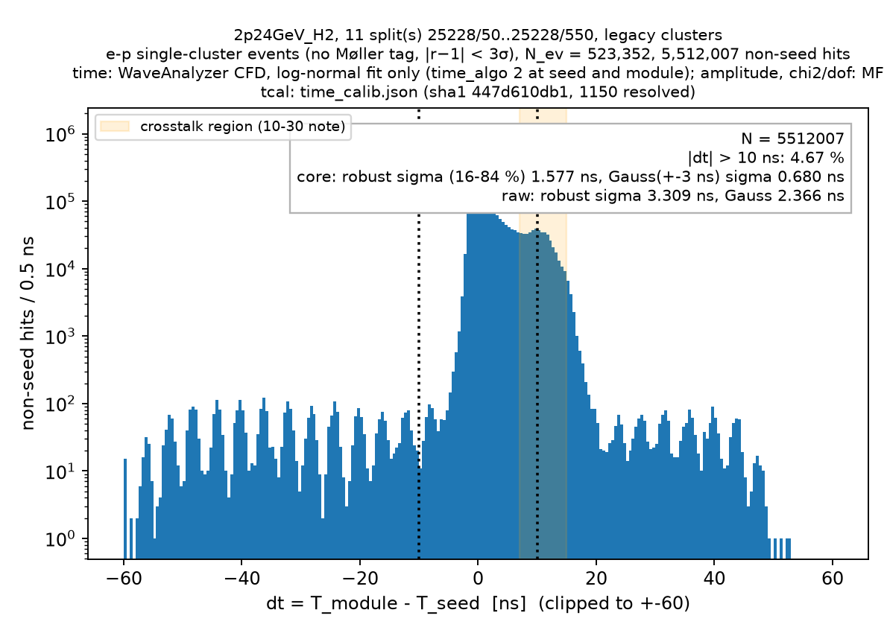
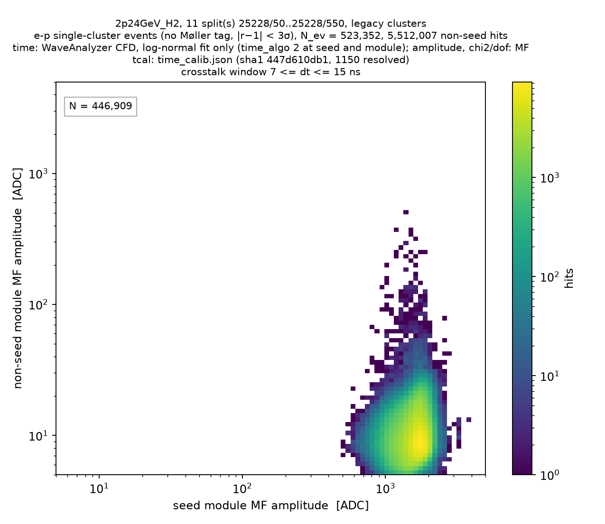
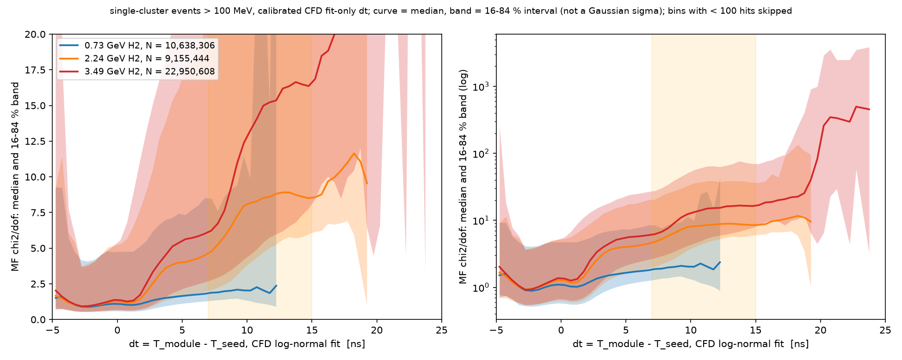
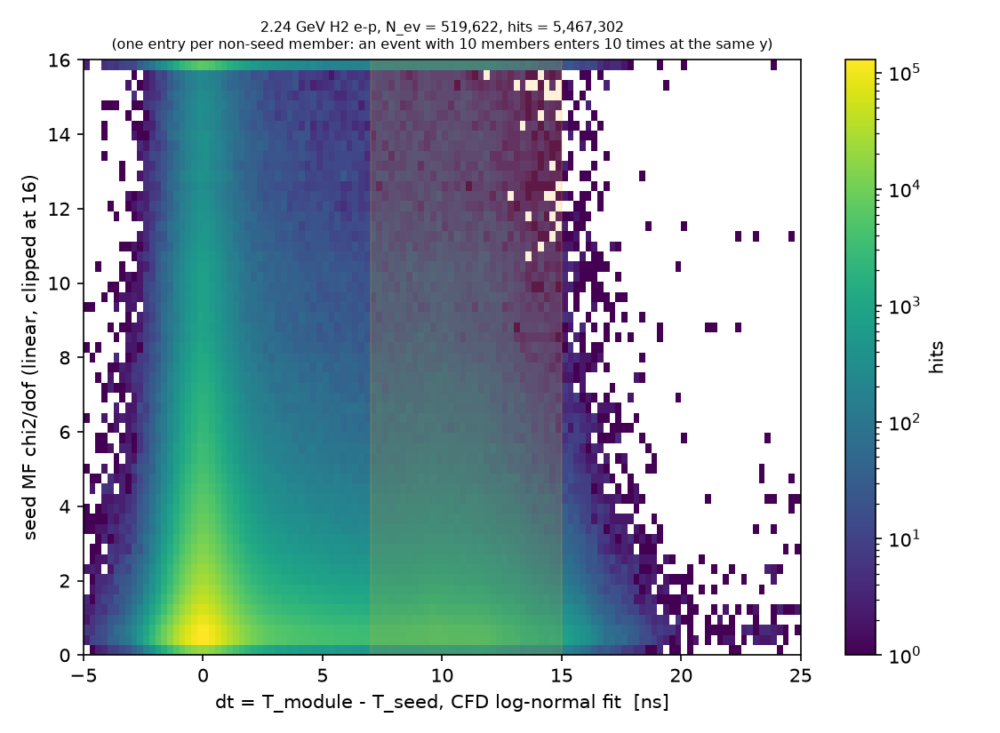

# Crosstalk in HyCal clusters: findings of the crosstalk_study

**Date:** 2026-11-07
**Context:** `crosstalk_study/` (full record: `README.md`; ratio tables under `tables/`; figures under `figures/`). Nothing in this directory is committed; the frozen benchmark, `database/` and `runinfo/` are not modified.
**Source of the numbers:** `README.md` and `tables/*.md|tsv`, except the fig4 amplitude statistics of finding 2b, which come from the `[fig4]` / `[fig4b]` stdout lines of `crosstalk_study.py` (not yet in the README).

Conventions: paths are relative to `crosstalk_study/`. dt = T_module − T_seed, positive = module later than the seed. The crosstalk window is dt = +7…+15 ns (the bump of the 10-30 note), the core is |dt| < 2 ns. "Window" and "core" ratios: (a) events with at least one non-seed hit in the region over all events of the selection, (b) hits in the region over all non-seed hits, h/ev = region hits per event.

## 1. Purpose and setup

The study measures, for every non-seed member of a single-cluster event, its time relative to the seed, its MF amplitude and its MF χ²/dof, to see what the late (crosstalk) population looks like and whether a cut can remove it. Events come from the frozen benchmark (`benchmark_hycal_timing_test_20261021.py`, sha1 `3293ab96…`) rerun with the r5ri chain's final job lines (`output/r5ri_20261104/jobs/final.txt`, runinfo calibration basis; the chain's 0.73 GeV lines carry the 3.5 GeV calibration file and were used unchanged) plus `--cluster-times --pulse-dump`. Run types: 0.73 GeV H2 (runs 24590, 24603), 2.24 GeV H2 (run 25228), 3.49 GeV H2 (runs 24386, 24503, 24512) and 2.24 GeV Ta X17 per run (25800, 26138, 26230; never pooled).

Selections: **e-p** = single-cluster, no Møller tag (`moller_pair` = `moller_kin` = `moller_rej` = 0), |r − 1| < 3 σ_CB with r = E_cluster / E′_ep(seed); **single** = every single-cluster event. The single-cluster threshold is the benchmark's `--signal-min`, 500 × kE MeV (162.7 / 500 / 779 MeV at 0.73 / 2.24 / 3.49 GeV) or an absolute 100 MeV (`cache/<slug>_e100`, a benchmark rerun). A fired-module cut n_mod < 20 (`wa20`: WaveAnalyzer peaks ≥ 20 ADC; `mf5`: MF pulses ≥ 5 ADC) exists as a variant.

Time sources: **MF** t = onset + t50 of the template fit, and **CFD** = the WaveAnalyzer log-normal CFD fit (`time_algo` 2 at seed and module; the CFD figures drop the 12.7 % (2.24) / 11.1 % (3.49) of hits without a WaveAnalyzer peak). Time calibration: `database/hycal_time_offsets/time_calib.json` (1152 entries, 1150 resolved, W495 = 0), constant per-module offsets subtracted from seed and module. The table is derived from the stored WaveAnalyzer peak time, so it is native to the CFD basis and cross-basis for MF.

## 2. Findings

### 2a. Raw dt shape: CFD shows the late shoulder, MF absorbs it

**Figure 1.** dt = T_module − T_seed over ±60 ns (log y), 2.24 GeV H2 e-p, calibrated CFD. The MF sibling is `../figures/2p24GeV_H2_mf/fig1a_dt_hist.png`, the uncalibrated one `../figures/2p24GeV_H2_raw/fig1a_dt_hist.png`.

At 2.24 GeV e-p the raw fraction of hits with |dt| > 10 ns is **4.75 % with CFD times and 1.00 % with MF times**, almost all late (257,496 late vs 4,148 early hits with CFD). The shoulder sits in the +7…+15 ns window of the CFD distribution and is much weaker in the MF one. The calibration narrows the core (Gauss σ 2.37 → 0.68 ns, CFD) but leaves the shoulder (4.75 → 4.67 %). A flat plateau at dt = −58…+52 ns (about 10–100 hits per 0.5 ns, 8 ns modulation) survives calibration in every set. The median module amplitude falls from about 20 ADC at dt = +3 ns to 7–10 ADC at +10…+18 ns (fig1b): the late hits are the smallest pulses. The raw MF shape agrees with the 10-30 sample (|dt| > 10 ns: 0.788 % old run 025320 vs 0.798 % run 25228).

### 2b. Window hits are small

**Figure 2.** MF amplitude of the seed (x) and of the non-seed member (y) for hits in the +7…+15 ns window, 2.24 GeV H2 e-p (N = 446,909). The 3.49 GeV version is `../figures/3p49GeV_H2/fig4_amp2d_crosstalk.png`.

The window hits have a median non-seed amplitude of 9.5 ADC (2.24 GeV) and 11.5 ADC (3.49 GeV), a median non-seed/seed ratio of 0.60 % and 0.50 %, and 57 % and 35 % of them lie below 10 ADC (Ta runs: 9.2–10.3 ADC, 0.57–0.71 %, 47–60 %). Core hits (|dt| < 5 ns) have medians of 33–35 ADC and 1.6–2.1 % of the seed. The e-p selection removes the fig3 wedge of the single-cluster samples (seed below about 500 ADC with a module amplitude comparable to or above the seed); e-p seeds stay at about 600–3000 ADC.

### 2c. Ratios: energy dependence and stability

| sample | selection | N_ev | non-seed hits | (a) window | (b) window | h/ev | (a′) core | (b′) core | h/ev core |
|---|---|---|---|---|---|---|---|---|---|
| 0.73 GeV H2 | e-p, 500 × kE | 1,080,125 | 4,720,970 | 0.61 % | 0.14 % | 0.006 | 99.98 % | 94.38 % | 4.125 |
| 2.24 GeV H2 | e-p, 500 × kE | 523,352 | 5,512,007 | 66.58 % | 8.11 % | 0.854 | 99.95 % | 81.23 % | 8.555 |
| 3.49 GeV H2 | e-p, 500 × kE | 1,191,910 | 16,571,558 | 87.07 % | 10.89 % | 1.513 | 100.00 % | 78.54 % | 10.920 |
| Ta 25800 | e-p, 500 × kE | 61,332 | 601,787 | 51.79 % | 6.56 % | 0.643 | 100.00 % | 79.66 % | 7.816 |
| Ta 26138 | e-p, 500 × kE | 14,222 | 130,083 | 42.10 % | 5.45 % | 0.498 | 100.00 % | 80.92 % | 7.401 |
| Ta 26230 | e-p, 500 × kE | 32,150 | 367,824 | 68.19 % | 9.25 % | 1.058 | 99.99 % | 69.11 % | 7.907 |
| 0.73 GeV H2 | single, 100 MeV | 2,713,040 | 10,638,306 | 0.32 % | 0.09 % | 0.003 | 99.15 % | 95.56 % | 3.747 |
| 2.24 GeV H2 | single, 100 MeV | 968,883 | 9,155,444 | 47.73 % | 6.28 % | 0.593 | 99.51 % | 84.16 % | 7.953 |
| 3.49 GeV H2 | single, 100 MeV | 1,723,192 | 22,950,609 | 80.99 % | 10.24 % | 1.364 | 99.98 % | 79.39 % | 10.574 |
| Ta 25800 | single, 100 MeV | 69,837 | 639,551 | 43.15 % | 5.78 % | 0.529 | 99.90 % | 81.25 % | 7.441 |
| Ta 26138 | single, 100 MeV | 15,217 | 131,398 | 35.81 % | 4.88 % | 0.422 | 99.92 % | 82.10 % | 7.090 |
| Ta 26230 | single, 100 MeV | 39,218 | 420,538 | 67.31 % | 9.60 % | 1.029 | 99.94 % | 70.54 % | 7.564 |

Legacy path, calibrated CFD fit-only; the full table with all variants is `tables/crosstalk_ratio.md`. The summary figure `../figures/summary/dtcfd_vs_mfchi2.png` shows the same samples as dt vs MF χ²/dof.

The energy ordering is **0.73 ≪ 2.24 ≈ Ta < 3.49 GeV**: 0.6 % of 0.73 GeV events have a window hit, against 67 % at 2.24 GeV, 42–68 % for the three Ta runs and 87 % at 3.49 GeV. Per event with a window hit there are 1.02 (0.73), 1.28 (2.24) and 1.74 (3.49) window hits. The ratios are stable against the cluster threshold (e-p, 500 × kE → 100 MeV: 66.58 → 66.60 % at 2.24 GeV, 87.07 → 87.09 % at 3.49 GeV). They are also stable against n_mod < 20: wa20 removes under 1 % of H2 events and leaves the ratios within 0.1 point; mf5 removes 4 % of 2.24 GeV and 18 % of 3.49 GeV events and moves the window ratios by up to about 4 points, at Ta. The single-cluster selection gives lower event ratios (a) than e-p (44.9 vs 66.6 % at 2.24 GeV, 500 × kE) with hit ratios (b) closer (5.9 vs 8.1 %); the cause was not studied.

The near-absence at 0.73 GeV (0.14 % of hits in the window) is consistent with a threshold effect. The median seed amplitude is 496 ADC against about 1700 ADC at 2.24 GeV (3.4 × smaller), so the expected crosstalk of about 0.6 % of the seed is 3 ADC, below the MF floor of 5 ADC. 14.67 % of the non-seed hits have no WaveAnalyzer peak (median MF amplitude 10.1 ADC), and the MF-time window hits (7,410) have a median of 6.7 ADC with 90 % below 10 ADC. **This is consistent with a threshold effect but not proven**: the sample cannot separate it from a true absence.

### 2d. MF χ²/dof flags the window hits, with a costly core tail

**Figure 3.** Median MF χ²/dof (curve) and 16–84 % band vs calibrated CFD dt in 0.5 ns bins, three H2 energies, single-cluster > 100 MeV (`tables/mfchi2_profile_vs_dtcfd.tsv`).

Window hits fit the template badly: median MF χ²/dof 8.1 (2.24 GeV e-p) and 13.4 (3.49 GeV), with 88 % and 94 % above 3 and 75 % and 80 % above 5. Core hits have a median of 1.25 and 1.32. A χ²/dof cut would reject core hits too: **25–27 % of core hits lie above 3 and 17–18 % above 5** (both selections, 2.24 and 3.49 GeV; `tables/dtcfd_vs_mfchi2.md`). At 0.73 GeV the window median is 1.9, close to the core.

The core tail was inspected in `../figures/examples/mfchi2_gt5_core_2p24GeV_H2.pdf`: 50 random 2.24 GeV hits with |dt| < 2 ns and χ²/dof > 5 (population 1,302,480), refitted with the benchmark's MF (recomputed χ²/dof equals the cached one, max |diff| = 0). The by-eye tally: 23 low-amplitude pulses (A below about 30 ADC, residuals at the level of ADC-step noise against a small σ_ped), 24 clean larger pulses with structured residuals at rise, peak and tail (template-shape mismatch, ±5 to ±20 ADC, χ²/dof 5–27), 3 marginal. None showed a second pulse, clipping or a baseline step. **In the 50 examples the core χ² tail comes from the template and the noise model**; none of them looks like crosstalk.

### 2e. Seed χ²/dof is uncorrelated with the window

**Figure 4.** χ²/dof of the seed's own MF pulse vs dt of each non-seed member, 2.24 GeV H2 e-p, single-cluster > 100 MeV (`tables/seed_chi2.md`).

In every sample the seed χ²/dof is uncorrelated with the non-seed amplitude and with dt (|Spearman| ≤ 0.075), and window hits have the same seed χ² as core hits (2.24 GeV: 0.999 vs 1.001). The seeds of crosstalk-window hits are not fitted worse. As a separate observation, the 3.49 GeV seeds fit worse than the others: median 2.08 with 31 % of events above 5, against about 1.0 (6–8 % above 5) at 2.24 GeV and Ta and 1.17 at 0.73 GeV.

### 2f. Self-referenced offsets agree locally with the official table

Offsets solved from the e-p sample itself (`tcal/<slug>_{mf,cfd}_selfref_offsets.tsv`, pair-network least squares) reproduce the official core width (Gauss 0.676 vs 0.679 ns, 2.24 GeV CFD) and agree with the table on seed-neighbour pairs (RMS 0.27 ns CFD / 0.41 ns MF at 2.24 GeV; 0.50 / 0.46 ns at 3.49 GeV). Module by module they differ by 1.8 / 1.7 ns (CFD / MF) at 2.24 GeV and 2.4 / 1.9 ns at 3.49 GeV (smooth large-scale modes the local network does not fix). The official table is kept.

## 3. Implications for rejection

The MF time alone hides crosstalk: with MF times the late population is 0.8–1.3 % of hits (raw, |dt| > 10 ns), but the same hits stand out in MF χ²/dof (median 8–13 in the window). A χ²/dof cut alone costs too much: a cut at 3 would remove 25–27 % of the core hits, a cut at 5 still 17–18 %, and in the 50 inspected examples the rejected core hits are template-mismatch and low-amplitude fits (2d). Candidate discriminants, none tested yet:

- t_CFD − t_MF per hit: the CFD keeps the late time that the MF absorbs, so their difference should separate the shoulder from the core without a χ² cut (median t_WA − t_MF is −0.60 ns at 2.24 GeV and −0.54 ns at 3.49 GeV; |difference| > 1 ns for about 29 % of all matched hits).
- An amplitude-dependent χ²/dof threshold, since about half of the inspected core-tail pulses (23 of 50) are below about 30 ADC and the window hits have medians of 9–12 ADC.
- A two-component MF (seed-time pulse plus a late pulse) for the small members.

Energy stake: 0.85–1.5 window hits per event (h/ev at 2.24 and 3.49 GeV) at about 0.5–0.6 % of the seed amplitude each. If crosstalk scales with the seed at about 0.6 % (2c), a 0.73 GeV crosstalk pulse of about 3 ADC is below the MF floor and cannot enter the cluster energy.

## 4. Open items

- Threshold vs rare at 0.73 GeV: overlay P(window hit) against seed amplitude across energies; a common curve would support the threshold hypothesis.
- Raw-waveform look at 0.73 GeV neighbours in the window region.
- The (t_CFD − t_MF) discriminant study of section 3.
- Template and noise-model improvement for the core χ²/dof tail (half low-amplitude, half shape mismatch in the 50 examples).
- Why the 3.49 GeV seeds fit worse (median 2.08, 31 % of events above 5).
- Figures not inspected by eye: all `_nmod20` sets, and fig5 for every sample except 3.49 GeV.
- The CFD fit path depends on an uncommitted `python/bind_dec.cpp` change (`dec.WaveAnalyzer.analyze_fit`); `--cfd-algo all` and `--time-source mf` work without it.
- Everything under `crosstalk_study/` is uncommitted (cache and figures regenerable).

## 5. Inventory

| Item | Content |
|---|---|
| `crosstalk_study.py` | benchmark rerun or ingest, cache, WaveAnalyzer pass, fig1–fig4, ratio json and `tables/crosstalk_ratio.md`, `--selfref` offsets |
| `summary_dtcfd_vs_mfchi2.py` | `figures/summary/dtcfd_vs_mfchi2*.{png,pdf}`, `tables/dtcfd_vs_mfchi2*.md` |
| `profile_mfchi2_vs_dtcfd.py` | `figures/summary/mfchi2_profile_vs_dtcfd*.{png,pdf}`, `tables/mfchi2_profile_vs_dtcfd*.tsv` |
| `examples_mfchi2_gt5.py` | `figures/examples/mfchi2_gt5_core_2p24GeV_H2.pdf` |
| `seed_chi2.py` | `seed_chi2` cache column, fig5/fig5b/fig5c, `tables/seed_chi2.md` |

Figure directories are `figures/<slug>[suffix]/`, slug = run type or `2p24GeV_Ta_X17_<run>`:

| suffix | set |
|---|---|
| none | e-p, calibrated CFD fit-only: the main set; fig5 exists only here |
| `_single`, `_single_e500` | single-cluster at 100 MeV, and at 500 × kE (kept for reference) |
| `_nmod20`, `_single_nmod20` | with n_mod < 20 (wa20) |
| `_raw`, `_mf`, `_cfd_all`, `_gated` | without time calibration; MF time; any `time_algo`; gated path (2.24 GeV only) |
| `summary/`, `examples/` | the three-energy summary and profile figures; the 50-example PDF |

Per set: fig1a dt histogram, fig1b dt vs amplitude, fig1c zoom, fig2 dt vs MF χ²/dof, fig2b dt vs log-normal χ²/dof (fit-only CFD sets), fig3 seed vs module amplitude, fig4 the same for window hits, fig4b for core hits, fig5 seed χ²/dof. The `_raw`, `_mf`, `_cfd_all` and `_gated` sets predate the 11-06 median-overlay removal and have no fig4.

Tables: `tables/crosstalk_ratio.md` (all variants, one `ratio_<slug>_<variant>.json` each), `dtcfd_vs_mfchi2[_nmod20].md`, `mfchi2_profile_vs_dtcfd[_nmod20].tsv`, `seed_chi2.md`. Caches: `cache/<slug>/` (500 × kE, legacy; 2.24 GeV also gated) and `cache/<slug>_e100/` (100 MeV), about 0.3–0.8 GB per run type; `tcal/` holds the self-referenced offsets. Benchmark outputs live in the session scratchpad (`ct_<slug>_bench`, `ct_<slug>_e100`) and are not needed with `--reuse`.
