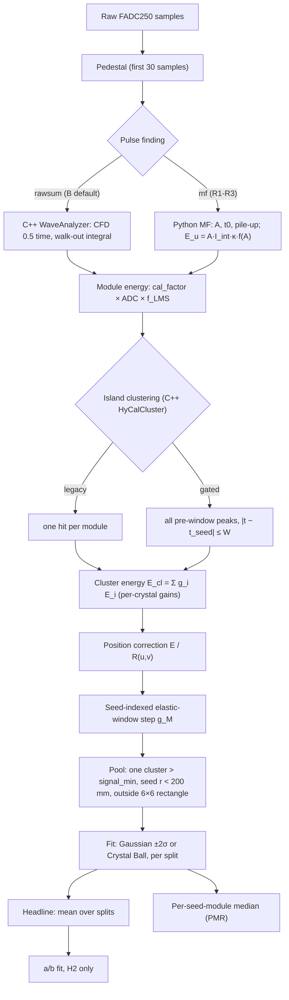
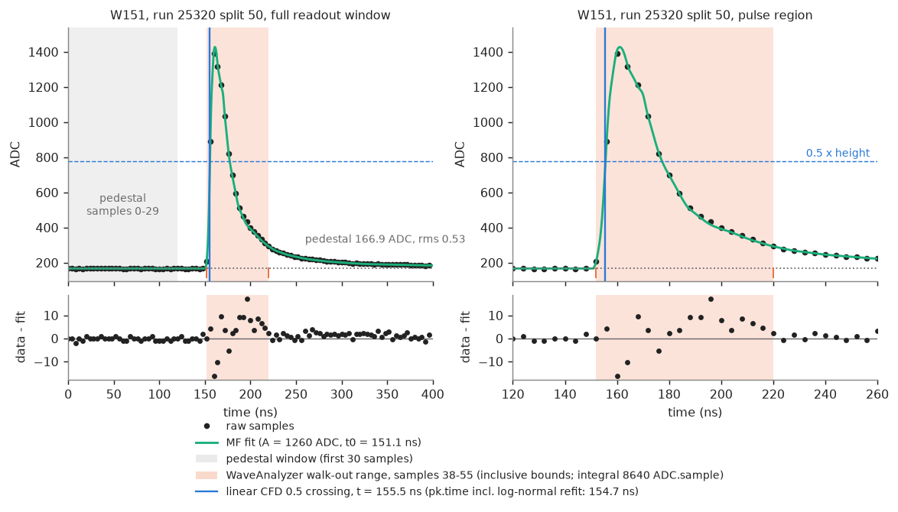
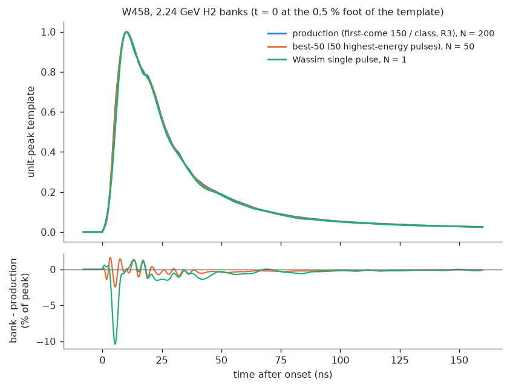
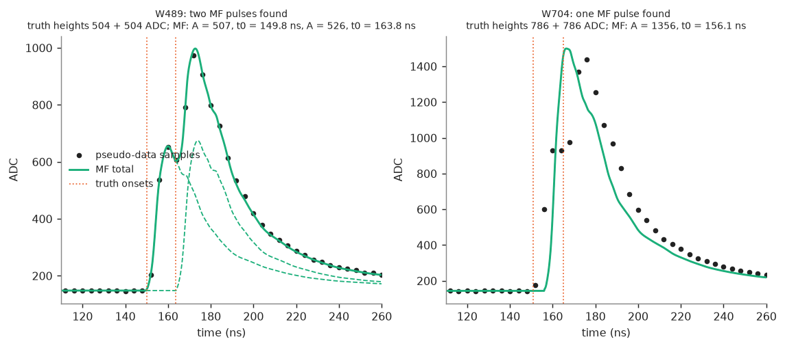
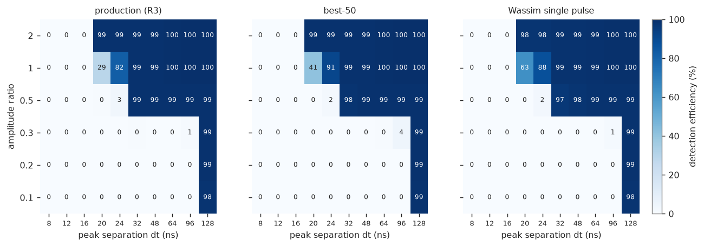
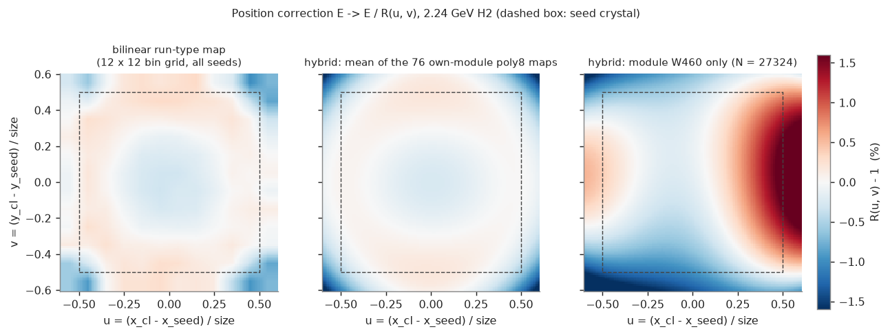
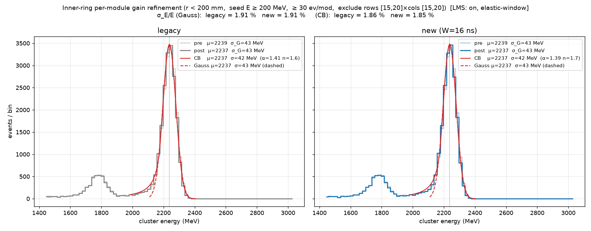
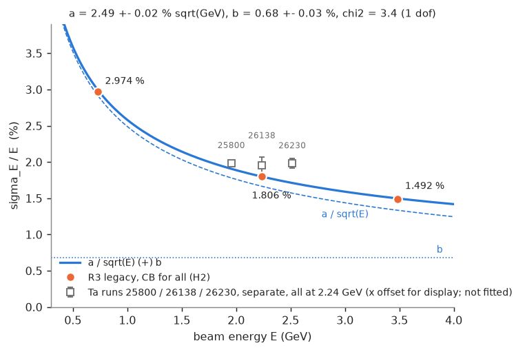
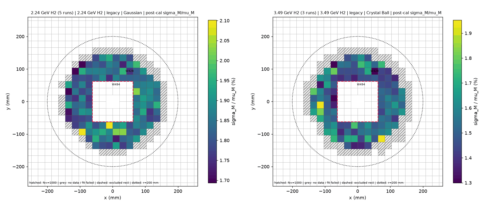

# PbWO4 energy resolution: methods summary (waveform to σ/E, R3 reference)

**Date:** 2026-10-27

## 0. Scope and keys

**Scope:** how the R3 σ/E headline and module medians are produced, from raw FADC samples to the a/b fit, plus every method tried and its status. Built from the reconciled fact sheet of 7 extraction reports; no new runs. Seed for the JINST methods section.

Citations use the keys below, as `KEY:line` or `KEY §section`. Paths are relative to `/Users/L00338853/work/PRad/prad2evviewer`. σ/E in %, Δ in pp, paired Δ = mean ± SE of per-split differences.

| Key | Path |
|---|---|
| B | `analysis/pyscripts/benchmark_hycal_timing_test_20261021.py` |
| PMR | `analysis/pyscripts/plot_module_resolution.py` |
| MF | `analysis/pyscripts/mf_pulse.py` |
| STE | `analysis/pyscripts/spline_template_extract.py` |
| PCC | `analysis/pyscripts/percrystal_calib.py` |
| PC | `analysis/pyscripts/position_corr.py` |
| GS22 | `analysis/pyscripts/gate_scan_20261022.py` |
| WA / WAh | `prad2dec/src/WaveAnalyzer.cpp` / `prad2dec/include/WaveAnalyzer.h` |
| HC / HCh | `prad2det/src/HyCalCluster.cpp` / `prad2det/include/HyCalCluster.h` |
| HS | `prad2det/include/HyCalSystem.h` |
| S | `analysis/pyscripts/notes/PbWO4_energy_resolution_summary.md` (updated to 10-27, S:3; no 20261024 daily note, N25:6) |
| N21..N27 | `analysis/pyscripts/notes/PbWO4_energy_resolution_202610DD.md` |
| by name | `analysis/pyscripts/_common.py`, `analysis/pyscripts/regauss_tables.py`, `analysis/pyscripts/output/resolution_fit_20261026/phase0.py`, `prad2det/src/HyCalSystem.cpp`, `prad2dec/include/Fadc250Data.h`, `database/reconstruction_config.json` (read-only), SC = `analysis/pyscripts/benchmark_hycal_timing_scan.py` (scan driver) |
| RS | `analysis/pyscripts/output/resolution_fit_20261027_best50/compare/r4_vs_r3_splits.tsv`: per-run Ta values = mean ± SE over that run's splits of the CB post column (pooled mean reproduces 1.978 / 1.878) |
| RM | `analysis/pyscripts/output/resolution_fit_20261027_best50/module_resolution/r3_ref/summary/runs_summary.tsv` (per-run module fits) |

> **Answer up front.** The headline σ/E and the module medians are both **cluster-energy resolutions**: fits of the calibrated cluster energy `cluster_E_cal` (PMR:130-134, 201-215, 437-439).
> - Headline: per split, one fit of the cluster-energy spectrum of all seeds in the inner-ring pool (seed r < 200 mm, seed E ≥ 200·kE, outside the central 6×6 rectangle); σ/E = σ/μ of the preferred fit; headline = mean over splits (B:2975, 3299; regauss_tables.py:69-97).
> - Module median: per seed module, fit only clusters whose seed is that module, N>1000; median over fitted modules of 100·σ/μ (PMR:130-134, 201-215, 437-439).
> - Neither is a single-module energy resolution. A module is not credited for clusters it merely belongs to.

## 1. Data flow

| Stage | Code | Quantity used by R3 |
|---|---|---|
| Pedestal, pulse finding | MF:845-853, 1176-1177 | MF pedestal, MF candidates |
| Pulse amplitude, time | MF:1060, 1236 | A, p_t0 (onset), p_time = p_t0 + t50 |
| Integral definition | WA:420-462, MF:1245-1258 | I_int(phase) of the noiseless unit template |
| Module energy | B:1309, 2540-2548; HS:154-158 | cal_factor · E_u · f_LMS |
| Clustering | HC, HCh via prad2py (B:2284-2300) | island clusters, legacy and gated |
| Gains | B:2749-2760; PCC | E_cl = Σ g_i E_i, `percrystal_spl` |
| Position correction | B:359, 2765-2795; PC | E / R(u,v), hybrid or bilinear map |
| Elastic-window step | B:516-648, 1755 | g_M per seed module |
| Pool and fit | B:308-325, 2400-2409, 2975, 3299 | σ/μ per split |
| Per-module | PMR:184-237, 393-446 | median of 100·σ/μ |

R1–R3 all run `--pulse-method mf` with spline banks `output/templates_spline`, κ = 1.0 and gains `percrystal_spl` (S:413). B defaults to `rawsum` (B:1892), which is the C++ WaveAnalyzer `pk.integral` (B:2536-2548). In mf mode the C++ code supplies the clustering, the integral definition used for I_int, and the fallback for channels the MF cannot fit (C++ `pk.time`, `pk.integral`; B:1541-1546). **The C++ CFD time is not used for energy.** Gate and pre-window time in mf mode: MF p_time (B:1538, 1300-1313); a per-module offset is subtracted only with `--time-calib`, which is off in R3 (raw times; B:1808, 2192-2195).

Terminology corrections:

| Term | Meaning in code | Source |
|---|---|---|
| W | `seed_time_window`, the seed-anchored timing gate (ns) of gated clustering; B default 8.0, working point 16 ns raw. It is not an integration window. | B:1714; N22:33; S:413 |
| Integration window | None fixed: the WaveAnalyzer integral walks out from the peak | WA:420-462 |
| Pre-window | Working point 100–200 ns; B code default 130–200 ns. Legacy keeps the largest-integral peak with pre_lo < t < pre_hi | N22:33, N25:894; B:1716, 2547-2549 |
| "first-come 150/class" | STE `select --per-module-cap 150`, applied separately to band b0 [300, 2500] ADC and non-b0, so ≤300 per module per split | STE:5719-5721, 724-731, 119, 748, 753 |
| "bowl" | Not in code: the even terms u², v², u⁴, v⁴ of poly8 | PC:583-612 |
| Rectangle / "2-ring" | `--exclude-rowcol 15 20 15 20`, 1-based, central 6×6 block = beam hole + 2 rings; x, y in [−62.3, 62.3] mm | B:1758-1768; N23:301; S:601 |

## 2. Waveform extraction

### 2.1 C++ WaveAnalyzer (rawsum path; defines I_int)

| Step | Rule | Source |
|---|---|---|
| Smoothing | triangular kernel, smooth_order = 2 | WA:235-250; WAh:58 |
| Pedestal | samples 0..29 of smoothed buffer; seed median, rms = 1.4826·MAD; σ-clip band max(rms, ped_flatness = 1.0), ≤3 iterations; trailing-window fallback if leading window suspicious, lower rms kept | WA:279-325, 620-653; WAh:65-67 |
| Threshold | thr = max(5·ped_rms, 10 ADC) | WA:657; WAh:59-60 |
| Peaks | local maxima on smoothed buffer, plateau handling; above thr over local baseline and pedestal; overlapping peak rejected if height < 0.3× previous; ≤8 peaks | WA:365-397, 405, 411, 489; WAh:61; Fadc250Data.h:20 |
| Overflow | flag raw ≥ 4095, not repaired | WA:588 |
| Time | quadratic peak fallback; height > 5σ: linear-interpolated CFD, fraction 0.5 (hard-coded) on smoothed rising edge; height > 10σ: log-normal LM fit (A, t0, μ, σ) on [int_left−4, raw_pos+4], analytic CFD overrides; time = samples × 4 ns − time_offset | WA:22-28, 31-231, 523-548, 555-561, 587, 683 |
| Integral | walk out from peak over smoothed − pedestal; sample "below" if v < 0.1·peak (int_tail_ratio), v < ped_rms or v < 0; stop after 2 consecutive below (tail_break_n), those discarded | WA:420-462; WAh:62-63 |
| Pile-up | flag only (Q_PEAK_PILED, gap 2 samples); two-τ LM deconvolution off by default, not called in B (inference: `_common.py:240` builds WaveAnalyzer without template store) | WA:565-577, 686-722, 825-1120; WAh:119 |

### 2.2 Python matched filter (MF; R1–R3)

| Step | Rule | Source |
|---|---|---|
| Pedestal | clipped mean of first 30 samples, σ = max(1.4826·MAD, 0.3) | MF:845-853 |
| Candidates | 3-sample moving-average peak > max(3σ, 3 ADC) | MF:1176-1177 |
| Bank | per module; TemplateBank two-τ (h50 `.dat`) or SampledTemplateBank spline npz; kernels L = 24 samples, 4 onset phases (1 ns grid); no amplitude classes in the filter; optional f(A), global or per module | MF:365-407, 476, 673-695, 708-770 |
| Fit | correlation scan over onsets, score C/√Σk²; A = C/Σk² (linear LS); accept A ≥ max(5σ_A, 5 ADC); parabola + 3 Gauss-Newton steps on (a, t0) | MF:834, 862-865, 903-934, 1042-1050, 1060, 1070-1075, 1081 |
| Time | p_t0 = template onset; p_time = p_t0 + t50 | MF:1236 |
| Energy | E_u = A · I_int(phase) · κ · f(A); κ CLI default 1.010, R1–R3 use 1.0 | MF:31-39, 1245-1258; B:1933; S:413 |
| Pile-up | subtract and repeat, kmax = 4; min separation 12 ns; inside parent span need A ≥ r_model·A_parent; joint amplitude solve + joint GN after each new pulse; r_model class default 0.05, B default 0.3 | MF:936-1024, 1081-1085, 1117-1128; B:1929 |
| Clipping | clipped samples weight 0; fallback to WaveAnalyzer peaks if <6 usable samples | MF:1195-1222 |
| Quality | χ²/dof with 0.03 model-error floor | MF:1132, 1156 |

r_model = 0.3 cut multi-peak channels from 13.4–14.0% to 3.6–4.0%, σ/E −0.002 ± 0.002 (N22:64). The 12 ns minimum separation prevents a −6 ns pre-pulse split in ~15% of large pulses (N22:61).

MF vs rawsum (MF − rawsum, pp): 3.49 −0.061 ± 0.006; 2.24 −0.040; C −0.073; 0.73 −0.306 (N22:74-81); summary range −0.04 to −0.31 (S:74).

*Fig. 2. One 25320.00050 pulse (W151) with the pedestal window, the WaveAnalyzer walk-out integration range (samples 38–55), the CFD 0.5 crossing and the MF template fit with residuals.*

### 2.3 Template building (STE)

| Subcommand | Function | Source |
|---|---|---|
| `select` | split → candidate npz | STE:1113 |
| `build` | pool, align, spline fit | STE:2826 |
| `ampcorr` | f(A) | STE:4051-4140 |
| `check` | held-out gates G1-4..G1-9 | STE:5556 |

Selection cuts (Selector.flush, STE:540-720): no sample ≥4095; A ≥ 50 ADC; peak sample ≤59; ≥20 pre-pulse samples; ped rms ≤1.5 and |slope| ≤0.05; tail back to baseline; no MF secondary ≥10%; MF onset ≥60 ns. `build` drops the worst 20% χ²/dof in iterations 1–2 (STE:1964-1990).

| Model element | Value | Source |
|---|---|---|
| Shape | cubic B-spline, knots denser near onset | STE:1727-1740 |
| Smoothness | penalty λ∫f''², λ = 1e4 default | STE:1477 |
| Tail | exponential from 140 ns to 400 ns | STE:1468, 1473 |
| Normalisation | unit peak; onset = last time ≤0.5% of peak | STE:1854-1873 |
| Alignment | 3 iterations | STE:1480 |
| Fallback | per-module template, run-type average if missing | STE:2355 |
| f(A) | PCHIP in ln A through band knots (lo 100–400, mid 400–1000, top 1000–2500 ADC); ratio of C++ walk-out integral to MF energy of noiseless band templates; one global f if run types agree within 2 SE | STE:2308-2345, 3481-3601, 3894 |

Production = "spline banks + 3-band run-type f(A)" (S:81).

### 2.4 Three template banks

| Bank | Selection | Build | Source |
|---|---|---|---|
| Production (R3) | first-come cap 150 per band per module and split (≤300 per split) | default `build` draws n-max 200, random order; exact options used: unverified (plan files only) | STE:5719-5721, 5801-5805, 724-731 |
| Best-50 (B50) | `--per-module-best K` by MF energy; E < 1.2 E_beam; exactly one MF pulse; ≤20 modules/event; trigger bit 24 vetoed | `--pool-order energy --n-max 50`; direct fit, 1.2% shape σ; λ ∈ {1e2, 1e3, 1e4} by held-out χ²; λ×10 on wiggles | STE:5718-5770, 2255-2262; S:92; N25 §4.10 |
| Wassim single-pulse | one pulse per module; peak 150–170 ns; A > 2 ADC; ≥20 pre samples; ≥4 rising, ≥10 falling; no secondary >15%; clip veto; ranked by background tier, amplitude, smoothness | cubic interpolating spline through 100 samples; no f(A) | STE:846-878, 3007-3062, 3169; N27:193-201 |

Outcomes (B50 on the full 118-split scan; Wassim on 4 splits per run type, legacy):

| Quantity | R3 | B50 (118 splits) | Wassim (4 splits/type; Δ is Wassim − B50) | Source |
|---|---|---|---|---|
| Δσ/E vs R3, 3.49 H2 | | +0.002 ± 0.005 | 1.488 vs R3 1.505, B50 1.507; Δ −0.020 ± 0.004 | N27:31-37, 246-252 |
| Δσ/E vs R3, 2.24 H2 | | +0.001 ± 0.002 | within errors | N27:31-37, 246-252 |
| Δσ/E vs R3, 0.73 H2 | | −0.004 ± 0.011 | within errors | N27:31-37, 246-252 |
| Δσ/E vs R3, 2.24 C | | −0.008 ± 0.007 | within errors | N27:31-37, 246-252 |
| Δσ/E vs R3, Ta 25800 (8 splits) | | +0.029 ± 0.015 legacy, +0.026 ± 0.018 gated | per-run n/a | RS |
| Δσ/E vs R3, Ta 26138 (4) | | +0.055 ± 0.035 legacy, +0.065 ± 0.024 gated | per-run n/a | RS |
| Δσ/E vs R3, Ta 26230 (13) | | +0.026 ± 0.036 legacy, +0.115 ± 0.037 gated | per-run n/a | RS |
| Δσ/E vs R3, Ta pooled, superseded | | +0.031 ± 0.020 legacy, +0.078 ± 0.022 gated | +0.020 ± 0.029 vs B50 | N27:31-37, 252 |
| Pile-up Eff_match (pooled) | 35.05% | 35.43% | 35.49% | N27:232-240 |
| Fake pulses / event | 0.032 | 0.026 | 0.027 | N27:232-240 |
| Cell Δt 20 ns, ratio 1 | 28.8% | 40.8% | 63.2% | N27:232-240 |
| Cluster σ_t, 2.24 / 3.49 | 0.135 / 0.143 ns | 0.107 / 0.097 ns | | S:579; N26 §9.4 |
| Shape | | | Wassim: χ² 2–4× B50; G1-5, G1-6 fail in all five run types | N27:223-226 |

Energy: B50 matches R3 within errors at H2 and C and is worse at Ta; not promoted (N27:66). Wassim is not worse than B50 and needs a full scan (N27:258-262).

*Fig. 3. Unit-peak template of module W458 at 2.24 GeV H2 from the production, best-50 and Wassim banks, with each bank's difference to production in % of peak.*

*Fig. 4a. Two pseudo-data waveforms (real pulse plus an injected template pulse, Δt_peak = 20 ns, ratio 1) with the MF decomposition: resolved in W489 and unresolved in W704.*

*Fig. 4b. MF two-pulse detection efficiency on the 10 Δt × 6 ratio cells for the three banks; values are means over the five run types, X17 included, as in `pileup_3way_cells.tsv`.*

## 3. Module energy and gains

| Step | Rule | Source |
|---|---|---|
| Module energy | `mod.energize(E_u · f_LMS)` = cal_factor · ADC, 0 if negative | B:1309, 2540-2548; HS:154-158 |
| cal_factor | runinfo calibration file; all 1152 PbWO4 modules non-zero in `calibration_factor_2p2_fadc.json`; lead glass 0 | B:2174; `_common.py:223` |
| LMS | (LMS2 + LMS3)/2 from `replay_gainCorr` ROOT files, normalised to first batch; `--lms-corr off` when file missing; effect Δ +0.000 ± 0.000 | B:881-955; N21:22-25; SC:415; S:98, 102; N25 §5 |
| Per-crystal fit | χ² = Σ_k w(Σ_i g_i E_ki − E'_k)² + Σ_i λ(g_i − g0)², i over cluster members, k over events in the seed's elastic window | PCC:7-9, 105, 231-233, 252 |
| Truth E'_k | elastic E'(θ) at the seed module centre minus energy loss; E_beam is not used | B:191-197, 217, 516-575 |
| Prior | g0 = Ē'/μ_global; λ = 30·(0.64Ē')²·w; module free if prior_frac < 0.5 | PCC:15-22, 163-166 |
| Iteration | ≤6 passes; windows refit in first 3, then frozen; `--fixed-windows` selects once | PCC:23-45 |
| Fit pool | exactly one cluster > signal_min (500·kE); seed r < 200 mm; seed E ≥ 200·kE; rectangle out | B:2158, 2400-2412, 1752, 308-325; PCC:560-585 |
| Fallbacks | never a member → g0; low statistics shrunk to g0; missing in table → g0 | PCC:242, 358-379 |
| `percrystal_spl` | this fit on the spline-bank dump, `--splits all --fixed-windows` → `output/percrystal_spl/<run>/gains_<run>_all.tsv` ("spl" = spline, inference) | plans/plan_best50_pipeline_20261026.md:28; S:413 |
| Apply | `--gain-file`: E_cl = Σ g_i E_i | B:2749-2760 |
| Seed-indexed step | per seed module CB pre-fit, window μ_M ± 2σ_M (`--window-nsigma 2`), g_M = E'(θ_M)/median in window; module excluded if elastic–Møller gap < 3σ_M or n < 30 in window; single pass | B:516-648, 1755, 1794 |

History: `cb-peak` and `median` are older options (B:258-305, 440-484); elastic-window agrees with cb-peak within 0.01 pp (N21:100-103). Per-crystal held-out Δ: 3.49 −0.066 ± 0.003, 2.24 −0.095, 0.73 −0.066 ± 0.022, C −0.091 (N23:79-86). The pooled `_all` gains are kept with an in-sample caveat (N23:115-137; S:541).

## 4. Clustering

`det.HyCalCluster` via prad2py, built twice in B (B:2284-2300); island algorithm ported from PRadIslandCluster (HCh:2, HC:2).

| Parameter / rule | Code default | Benchmark | Source |
|---|---|---|---|
| min_module_energy | 0 | 1.0 (config) | HCh:36-39; reconstruction_config.json:15-17 |
| min_center_energy | 10 MeV | 10 (config) | HCh:36-39; reconstruction_config.json:15-17 |
| min_cluster_energy | 50 MeV | 50 (config) | HCh:36-39; reconstruction_config.json:15-17 |
| min_cluster_size | 1 | config value unverified | HCh:36-39 |
| Fields copied from config | | 8 | B:2285-2287 |
| Seeding | hits sorted by E; largest unconsumed hit ≥ min_center_energy | same | HC:156-174 |
| Growth | BFS over edge neighbours, one pulse per neighbour module, no size limit | same | HC:177-212 |
| corner_conn | false | false | HCh:42 |
| Local maximum | E ≥ min_center_energy, no neighbour (incl. corners) higher | same | HC:243-275 |
| Split | profile-based, 6 iterations, drop fraction < 0.01; none if ≥100 hits or ≥10 maxima | same | HC:223-225, 281-415; HCh:43-44 |
| Profile | Geant4 in production | SimpleProfile | S:134 |
| Energy | sum of split-weighted hit energies | same | HCh:99-103 |
| Non-linearity | on | on, PbWO4 coefficients 0 → identity | HCh:50; HC:469-482; S:126; N25 §6 |
| Leakage correction | off | off | HCh:52 |
| Depth correction | exists, not called in clustering | not called | HC:31-37 |
| Position | log-weighted centroid over seed 3×3, w = max(0, 3.6 + ln(E_i/E_tot)) | same | HC:20, 429-507; HCh:47 |
| seed_time_window | −1 (off) | legacy off; gated W | HCh:76; HC:200, 336 |
| Boundary flags | kInnerBound/kTransition/kOuterBound | not used to exclude; exclusion in the Python pool | HyCalSystem.cpp:266-309 |

| Mode | Hits per module | Gate | Source |
|---|---|---|---|
| Legacy | one: largest-integral peak in pre-window | none | B:2538-2549 |
| Gated | every pre-window peak | \|t − t_seed\| ≤ W in BFS | B:2538-2549; HC:200, 336 |

## 5. Cluster-energy corrections

Position correction fits r = `cluster_E_cal`/E'(seed) against (u, v) = (centroid − seed centre)/module size (PC:6-8, 140-143). Pool: seed r < 200 mm, rectangle out (PC:128-134). Per bin, the run-type preferred estimator, r ∈ [0.85, 1.12], ≥30 events (PC:89-90). B applies E → E/R(u, v) after `--gain-file` and before the seed-indexed step; schema detected (B:359, 2765-2795).

| Map | Form | Source |
|---|---|---|
| bilinear `poscorr_v1` | 12×12 bins over ±0.6; sparse bins filled by neighbour mean; normalised to n-weighted mean 1 | PC:548-581, 615, 1035 |
| poly8 | R = c0(1 + c1u² + c2v² + c3u²v² + c4u⁴ + c5v⁴ + c6u + c7v) | PC:583-612 |
| hybrid `poscorr_hybrid_v1` | own poly8 per seed module with ≥3000 clusters (6×6 grid, ±2σ truncated mean, ≥10 bins, R in [0.9, 1.1]); else bilinear | PC:778-911, 924 |

| Reference | Map | Source |
|---|---|---|
| R1 | none | S:413 |
| R2 | bilinear per run type; Ta uses the 2.24 H2 map | S:413 |
| R3 | hybrid at 3.49 H2, 2.24 H2, C; bilinear kept at 0.73 H2 and Ta | S:413 |

| Run type | Own-fit modules (R3) | Events covered | R2 − R1 | R3 − R2 in-sample | R3 − R2 held-out |
|---|---|---|---|---|---|
| 3.49 H2 | 52/170 | 78% | −0.099 ± 0.005 | −0.118 ± 0.007 | −0.097 |
| 2.24 H2 | 76/165 | 88% | −0.010 ± 0.001 | −0.044 ± 0.002 | −0.035 |
| 2.24 C | 28/191 | 56% | −0.027 ± 0.003 | −0.034 ± 0.005 | −0.016 |
| 0.73 H2 | 25/141 | | +0.005 ± 0.008 | hybrid would be +0.191 ± 0.040 (CB +0.127 ± 0.014): rejected | |
| 2.24 Ta (pooled, superseded; per-run n/a) | 0/40 | | −0.021 ± 0.021 | | |

Sources: S:507-513; N25 §4.6-4.9; N26 §2; S:524. A global map was rejected: leave-one-out agreement 0.31–0.91 < 0.95 (N25 §4.3).

Exclusion rectangle: the old off-centre reading (bug in `_select_pool`) was replaced by the centred 1-based 6×6 block (N23:299-306). Old → centred: 3.49 −0.003 ± 0.010; 2.24 −0.061 ± 0.002; 0.73 +0.154 ± 0.019; C −0.037; Ta −0.313 ± 0.055 (pooled, superseded; per-run n/a). Events per split roughly halve at 2.24 and C (N23:322-339).

*Fig. 6. R(u,v) − 1 at 2.24 GeV H2 for the bilinear run-type map, the mean of the 76 own-module hybrid poly8 maps, and module W460 alone.*

## 6. Resolution extraction

| Item | Rule | Source |
|---|---|---|
| Event | exactly one cluster > signal_min = 500·kE MeV, kE = E_beam/2239.51 | B:2151, 2158, 2400-2409; S:30 |
| Pool | seed r < 200 mm; seed E ≥ 200·kE; seed outside rectangle | B:308-325, 1752; S:30 |
| Møller veto | off by default (`--veto-second-cluster` default None) | B:1815 |
| Ta (X17) runs | **not combined.** Runs 25800, 26138, 26230 are reported separately; a pooled Ta value is marked "pooled, superseded". Reason (user): resolution may have degraded during the X17 running | user rule, 2026-10-27 |
| Quantity | post-calibration cluster-energy spectrum of the pool; σ/E = sig_post/mu_post (Gaussian) or sig_cb/mu_cb (CB) | B:2975, 3299 |
| Gaussian ±2σ | default since 10-24 (`--gauss-window 2sigma`); start from fixed ±150·kS MeV about argmax; refit in [μ−2σ, μ+2σ] until μ and σ change < 1%, ≤5 refits | B:651-688, 703-771, 1736; S:236-241 |
| CB | `fit_peak_cb` | B:223-255 |
| Splits | one EVIO split file per B job; headline = mean over splits; run 24578 excluded | SC:396-433; regauss_tables.py:69-97, 137; S:30 |
| Uncertainty | absolute SE of the headline not quoted; comparisons use paired Δ | S:8, 413 |
| SE code | std(ddof=1)/√n; whether all tables use it: unverified | phase0.py:114 |
| Gated vs legacy | both per split; legacy is the headline column | S:31-32 |

At 0.73 GeV, 5/16 post spectra hit the 5-refit cap (N25:84-87; S:258). The ±2σ window moved 0.73 from 4.366 to 3.713.

Preferred fit (GS22:139-141; S:18-24):

| Run type | Preferred fit |
|---|---|
| 3.49 H2 | CB |
| 2.24 H2 | Gaussian ±2σ |
| 0.73 H2 | Gaussian ±2σ |
| 2.24 C | CB |
| 2.24 Ta | CB |

Per-module (PMR; B has no per-module fit): same pool cuts; group by `seed_module_id`; fit `cluster_E_cal_MeV` of clusters whose seed is that module with the run's preferred fit (`GAUSS_RUNS`); require N > 1000 (`--min-n 1000`); `--group-runs` pools the runs of a run type; median over fitted modules of 100·σ/μ (PMR:130-134, 184-237, 393-446, 525-528).

a/b: σ/E = a/√E ⊕ b on H2 only (E = 0.727, 2.236, 3.484 GeV), SEM-only weights, 1 dof (S:184-219).

*Fig. 5. Cluster-energy spectrum of split 25320.00050 (R3, legacy and gated panels, before and after the seed-indexed elastic-window step) with the Crystal Ball (solid) and iterative ±2σ Gaussian (dashed) fits; reused from `output/scan_20261025/pos_hybrid/scan_025320/split_00050/result_calibrated.png`.*

## 7. Methods tried

| Method | Where | Outcome | Status |
|---|---|---|---|
| MF vs rawsum | MF; B:1892 | −0.04 to −0.31 pp | adopted (mf) |
| h50 two-τ vs background shape | MF bank | h50 better in every module (N22:42, 56) | superseded by spline |
| Free-τ bounded | MF bank | +0.026 / +0.081 (N23:157-189) | rejected |
| τ prior | MF bank | N23:157-189 | study only |
| Seed-model weights | MF | N23:157-189 | rejected |
| Spline vs h50 | STE | 3.49 1.823→1.709 (−0.114 ± 0.006); 2.24 2.071→1.952 (−0.119); 0.73 4.440→4.366 (−0.074) (N23:423-463) | adopted |
| Finer f(A) bands | STE ampcorr | N25 §3.2 | rejected |
| Per-module f(A) | STE ampcorr | +0.029..+0.044 (N25 §3.3; S:90) | rejected |
| Amplitude-indexed shape | STE | S:89 | study only |
| Best-50 bank | STE | equal at H2/C; Ta worse, per run gated +0.026 / +0.065 / +0.115 (RS; pooled N27:31-37, 66 superseded) | not promoted; decision open (S:578) |
| Wassim single-pulse bank | STE | 3.49 −0.020 ± 0.004 vs B50 on 4 splits (N27:246-252) | needs full scan (N27:258) |
| r_model 0.3 | B:1929 | multi-peak 13.4–14.0% → 3.6–4.0%, −0.002 ± 0.002 (N22:64) | adopted |
| LMS correction | B:881-955 | +0.000 ± 0.000 (S:98) | in chain, null |
| cb-peak / median gains | B:258-305, 440-484 | elastic-window equal within 0.01 pp (N21:100-103) | superseded |
| Per-crystal gains | PCC | held-out −0.066 to −0.095 (N23:79-86) | adopted (`percrystal_spl`) |
| Global position map | PC | leave-one-out 0.31–0.91 (N25 §4.3) | rejected |
| Bilinear position map (R2) | PC | −0.099 to +0.005 (N25 §4.6-4.8) | adopted at 0.73, Ta |
| Hybrid position map (R3) | PC | −0.034 to −0.118 in-sample (N25 §4.9) | adopted at 3.49, 2.24 H2, C; rejected at 0.73 |
| Centred exclusion rectangle | B:1758-1768 | N23:322-339 | adopted (bug fix) |
| Gaussian ±2σ window | B:1736 | 0.73 4.366 → 3.713 | adopted (default since 10-24) |
| CB for all run types | B:223-255 | a/b usable (N27:57) | used for a/b |
| Corner connectivity cc1 | HC | no winner (N25 §6; S:126-131) | rejected |
| min_module_energy 0.5 / 2 / 5 | HC | no winner (N25 §6) | rejected |
| non_linear_corr 0 | HC | exact null (S:126) | rejected (identity) |
| Gate W, raw 4..100, cal 2..16 | B:1714 | W=4 raw +0.45; tcal W=2 +0.14; W=8 fails ε_peak; W=16 raw neutral e-p/C, Ta −0.087 ± 0.046 pooled, superseded; per-run n/a (N22:24-35, 167-170) | W=16 raw; not re-selected on R3 (S:582) |
| Pre-window LO 100–140 | B:1716 | flat ≤0.007 (N22:25, 32) | 100–200 working point |
| Pre-window HI 220 | B:1716 | fails ε_yield on Ta, pooled (N22:25, 32) | rejected |
| CFD fraction | WA:523 | timing only; Python scan done 10-27, 1 split each at 0.73, 2.24, 3.49 H2 and Ta 25800 (no C; N27:109): f = 0.6 best without phase correction; log-normal refinement worsens σ_t (S:580; N27 §5) | C++ decision pending |
| MF per-module time offsets | MF | N22:150-161; S:115 | rejected |
| Seed-time neighbour amplitudes | B | +0.015 / +0.016 at 2.24 / C (N23:139-153) | rejected |
| Single-pulse event cuts | B | N22:108-120 | study only |
| Møller veto | B | N25 §7; S:173-180 | rejected for reference |
| Møller-gap re-admission | B | +1.09 ± 0.11 (S:175) | rejected |
| C++ two-τ deconvolution | WA:686-722 | off by default (WAh:119) | not used |
| RF per-run timing calibration | Python | N25 §9.7; N26 §3; S:571 | kept in Python only; absent from database |

## 8. Current reference R3

R3 = MF with production spline banks (3-band run-type f(A)), κ = 1.0, `percrystal_spl` gains, hybrid position maps at 3.49 H2, 2.24 H2 and C, bilinear at 0.73 H2 and Ta, seed-indexed elastic-window step, centred rectangle, preferred fit per run type, gate W = 16 ns raw, pre-window 100–200 ns (S:413; S:81).

Headline σ/E (%), mean over splits (S:425-489; medians S:495-499, N27:47-51):

| Run type | Fit | Splits | R3 legacy | R3 gated | R2 | R1 | Median R3 (modules) |
|---|---|---:|---:|---:|---:|---:|---:|
| 3.49 H2 | CB | 27 | 1.492 | 1.491 | 1.610 | 1.709 | 1.519 (111) |
| 2.24 H2 | G ±2σ | 42 | 1.854 | 1.853 | 1.898 | 1.908 | 1.842 (122) |
| 0.73 H2 | G ±2σ | 16 | 3.718 | 3.714 | 3.718 | 3.713 | 3.497 (98) |
| 2.24 C | CB | 8 | 1.797 | 1.797 | 1.831 | 1.858 | 1.810 (78) |
| Ta 25800 | CB | 8 | 1.986 ± 0.028 | 1.938 ± 0.030 | n/a | n/a | none (0 modules N > 1000) |
| Ta 26138 | CB | 4 | 1.950 ± 0.114 | 1.920 ± 0.111 | n/a | n/a | none (0) |
| Ta 26230 | CB | 13 | 1.983 ± 0.066 | 1.828 ± 0.056 | n/a | n/a | none (0) |
| Ta pooled, superseded | CB | 25 | 1.978 | 1.878 | 1.978 | 2.000 | 1.908 (8) |

Module-median history, h50 → spline → R1 → R2 → R3:

| Run type | h50 | spline | R1 | R2 | R3 |
|---|---:|---:|---:|---:|---:|
| 3.49 H2 | 1.74 | 1.61 | 1.61 | 1.58 | 1.52 |
| 2.24 H2 | 2.05 | 1.92 | 1.87 | 1.88 | 1.84 |
| 0.73 H2 | 3.70 | 3.60 | 3.52 | 3.50 | 3.50 |
| 2.24 C | 1.98 | 1.83 | 1.83 | 1.83 | 1.81 |
| Ta pooled, superseded | 1.93 | 1.99 | 1.99 | 1.91 | 1.91 |

a/b fit, H2 only, SEM-only, 1 dof (S:184-219):

| Reference | Estimator | a (%·√GeV) | b (%) | χ² | Source |
|---|---|---:|---:|---:|---|
| R3 | CB for all | 2.49 ± 0.02 | 0.68 ± 0.03 | 3.4 | N27:57 |
| R3 | preferred | 3.18 ± 0.01 | −0.98 | 374 | N27:59; S:211-219 |
| R2 | CB for all | 2.37 | 0.98 | | S:197 |
| R1 | CB for all | 2.20 | 1.20 | | S:195 |

**CB for all is the usable estimator.** The preferred-estimator fit gives b < 0 and χ² = 374, so it is unusable. A 3-term fit at R3 is unphysical (c² < 0) (S:200, 219). The constant term ≈43% of σ² at 3.49 GeV is an R2-based figure (S:218-219). Ta did not enter any a/b fit (H2 only, S:184); under the Ta rule the fit will be redone with the three per-run Ta points entered separately.

*Fig. 7. R3 σ_E/E (CB for all) at the three H2 energies with the R3 CB-for-all a/√E ⊕ b curve (a = 2.49, b = 0.68; N27:57; no refit), plus the three Ta runs as separate points that are not in the fit.*

*Fig. 8. Per-seed-module σ_M/μ_M on the HyCal face for R3 at 2.24 GeV H2 and 3.49 GeV H2 (medians 1.842 % and 1.519 %); colour scales differ between panels.*

## 9. Open caveats

- Gains and R3 hybrid maps are in-sample; held-out gains: 0.01–0.02 pp smaller (S:541).
- Gains not refit after position correction (S:542).
- Peak-yield ratio R2/R1 = 0.986 at 0.73 GeV not investigated (S:543).
- Ta has ≈16 calibrated modules per split (S:546). No Ta run reaches N > 1000 in any module on its own (RM), so per-run module medians do not exist.
- Ta per-run R3 legacy values agree within 1 SE (§8); per-run R1/R2 values were not extracted (RS).
- Gate W not re-selected on R3; Ta rescan deferred (S:582).
- Hybrid map code uncommitted (S:547, 592).
- B uses SimpleProfile, production uses Geant4 profiles; docs clustering constants disagree with the JSON in three places (S:134, 145-149).
- C++ deconvolver still two-τ; spline and best-50 banks not in C++ (S:566).
- Possible ±0.4% sub-sample-phase bias of the MF energy, measured with the production (R3) bank on best-50 candidates; untested reading (S:92; N25:881).
- Split count: 118 vs 119 disagreement (S:602).
