# Crosstalk study of bad MF fits: figures

**Date:** 2026-10-30
**Context:** [PbWO4_energy_resolution_20261030.md](PbWO4_energy_resolution_20261030.md) §6 (summary and consequences). This note shows the figures behind it.
**Source:** `output/crosstalk_20261029/` (`figs/`, `tables/`, `tools/`). The figures below are copies in `notes/figures/crosstalk_20261030/`; nothing in `output/` was changed.

## What this is about

Here crosstalk means a signal coupled into a channel from another readout channel; it is distinct from external electronic pickup and from shower leakage (real energy in a neighbouring crystal), and the study's tables and scripts in `output/crosstalk_20261029/` call it "pickup".

A small HyCal pulse can be fitted badly by the matched filter (MF) for two different reasons.

- **Crosstalk.** A large pulse in one FADC channel (the seed) leaks about 1–1.4 % of its height into another channel. In that channel it appears as a narrow bipolar spike: a small dip, a sharp peak about 12 ns after the seed peak, then an undershoot. The scintillation template cannot describe this shape, so the fit is bad. These spikes make up about 26 % of the bad fits at 20–50 ADC. They are almost never cluster members (0.2 %), because they arrive outside the 4 ns cluster time gate.
- **Normal-shaped in-time members.** About 55–60 % of the bad fits at 20–50 ADC are ordinary cluster members. They have normal pulse shapes, arrive in time with the seed, and have MF amplitude equal to the pulse height. The likely cause, inferred from the trends below but not tested, is that the 3 % model term of the noise model is too small, or that the template shape does not match at larger amplitude.

Another roughly 10 % of bad fits are in-time hits that are not tagged bipolar but still show a crosstalk excess. The crosstalk-associated share at 20–50 ADC is therefore about 26–36 %.

**Sample.** Four EVIO splits, one per e-p/C run type: 24590_00010 (0.73 GeV, H2), 25228_00050 (2.24 GeV, H2), 25308_00050 (2.24 GeV, C), 24386_00010 (3.49 GeV, H2). No Ta split. Pulses of 20–200 ADC with the event and waveform selection of `waveform_good_bad.py collect` (976,750 pulses at 20–50 ADC). Seed waveforms are stored only for the 3.49 GeV split, so the waveform-model figures use that split alone.

**Definitions.**
- Good fit: MF χ²/dof < 2. Bad: > 3. In between ("mid"): 2–3.
- h: WaveAnalyzer (WA) pulse height of the hit. seed_h: height of the cluster seed. dt_seed: hit peak time minus seed peak time.
- Distances are from the seed module, in module units (mu).
- Strict bipolar tag ("bipS"): FWHM < 15 ns and (pre-dip/peak < −0.15 or undershoot/peak < −0.10). Loose tag ("bipL"): FWHM < 15 ns or either dip condition. Both thresholds are this study's choice.
- Adjacent ("adj"): same crate and FADC slot as the seed, channel number differs by 1.
- In legends, "0.73", "2.24H2", "2.24C" and "3.49" are the four splits, and "pooled" is all four together.

## 1. Crosstalk shape

### 1.1 Average waveforms by class

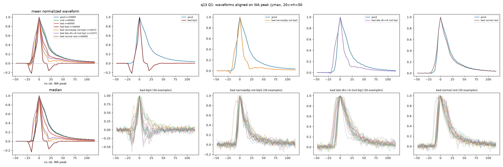

**Plotted.** Waveforms at 20–50 ADC, all splits pooled, aligned on the WA peak and divided by the peak value; time is in ns from the peak. The left column shows the mean (top) and median (bottom) of every class, with at most 60,000 hits per class. The other columns compare one bad sub-class with the good hits (top) and show 30 single examples of that sub-class (bottom). The sub-classes are: strict bipolar (bipS); narrow or dipped but not strict bipolar; late (dt_seed ≥ 6 ns) and not bipolar; and the normal remainder.

**What to see.** The strict-bipolar mean has a dip of about −0.2 at −16 ns, a narrow peak, and an undershoot of about −0.15 at +16 ns. It has no scintillation tail. The single examples show the same shape hit by hit. The "narrow or dipped" class is a weaker version of it. The normal remainder lies almost on top of the good hits.

**Meaning.** The bad class contains two different populations. One has a shape that no scintillation template can fit (crosstalk). The other, the normal remainder (62.8 % of bad hits), has the same average shape as good hits, so its bad χ² must come from something other than an obvious shape difference.

### 1.2 Per-hit distributions, good vs mid vs bad

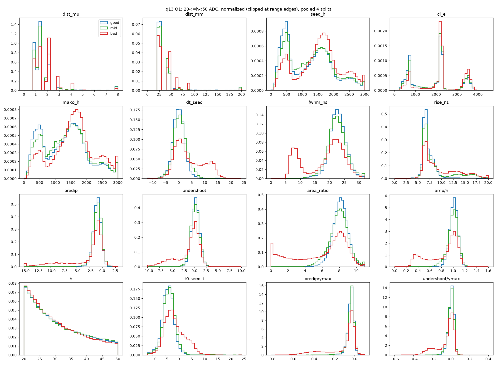

**Plotted.** Normalized histograms of 16 per-hit quantities at 20–50 ADC, all splits pooled, for good (blue), mid (green) and bad (red) hits. Values outside the plotted range are put in the edge bins.

**What to see.** Most bad-hit distributions have a second component that good hits lack:
- FWHM peaks at 6–10 ns, against about 22 ns for good hits.
- dt_seed has a shoulder from +5 to +15 ns.
- amp/h has a bump at 0.3–0.5.
- Pre-dip and undershoot have long negative tails.
- seed_h is shifted towards 1500–2000 ADC.
- dist_mu has excess at a few discrete distances between 2 and 4.5 mu.

The main component of each bad distribution sits where the good one does.

**Meaning.** Section 1.1 averages over hits. This figure shows that the crosstalk signature belongs to a distinct sub-population: the bad hits as a whole are not shifted. Crosstalk hits are narrow, late, and low in MF amplitude, and they follow large seeds. The amplitude deficit (median amp/h 0.5–0.6 for bad non-members at 2.24 and 3.49 GeV, `tables/q56_amp.txt`) belongs to this sub-population; bad cluster members have amp/h 0.99–1.03.

### 1.3 Adjacent-channel hits in units of the seed (3.49 GeV)

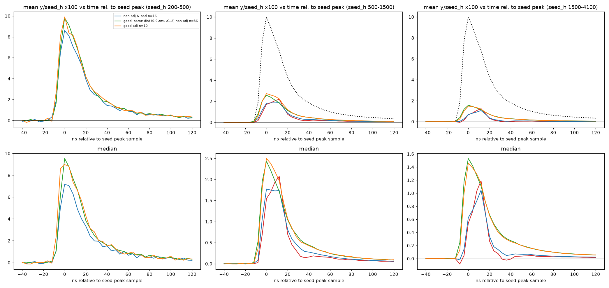

**Plotted.** 3.49 GeV split, hits at 20–50 ADC. Each hit waveform is divided by the seed height and shown in percent, against time from the seed peak sample (4 ns samples). The columns are bins of seed height (200–500, 500–1500 and 1500–4100 ADC); the top row is the mean and the bottom row the median. The curves are:
- red: adjacent-channel bad hits;
- blue: non-adjacent bad hits;
- green: good non-adjacent hits at 0.9–1.2 mu;
- orange: good adjacent-channel hits.

The dotted black curve is the mean seed pulse divided by 10. The legend sits in the first panel, where the red class has fewer than 10 hits and is not drawn, so the red curve has no legend entry.

**What to see.** At seed 200–500 ADC every class is an ordinary in-time pulse of about 8.5–10 % of the seed: this is real shower leakage. At larger seeds the good hits still peak at 0 ns with a scintillation tail. The adjacent-channel bad hits instead peak 3 samples (+12 ns) after the seed peak, at a mean of 2.2 % (seed 500–1500 ADC) and 1.25 % (seed 1500–4100 ADC) of the seed. They are narrower than the seed pulse and have almost no tail. At 1500–4100 ADC the median dips slightly below zero before the rise. The non-adjacent bad hits show the same late peak mixed with an in-time component.

**Meaning.** The adjacent-channel bad hit is a delayed, narrow copy-like response to the seed, with a size of order 1 % of the seed height. That is the crosstalk signature, measured directly against the seed that causes it.

### 1.4 Single adjacent-channel hits with seed-based models (3.49 GeV)

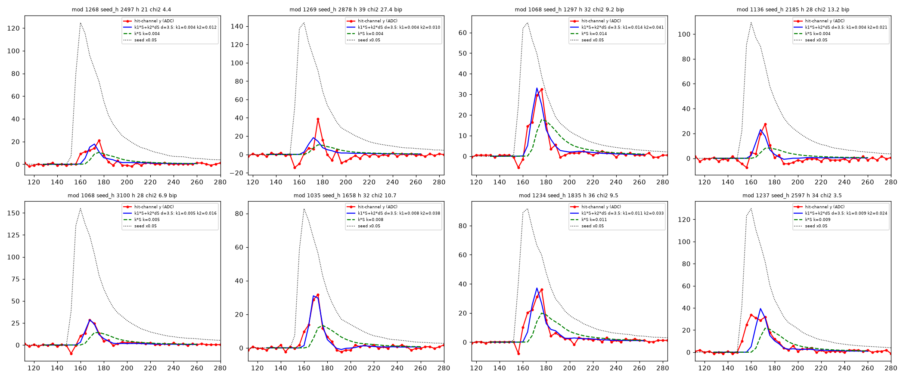

**Plotted.** Eight randomly chosen adjacent-channel bad hits at 20–50 ADC with seed height ≥ 500 ADC, 3.49 GeV split, against time in ns:
- red: the pedestal-subtracted hit waveform;
- dotted: the seed waveform × 0.05;
- green dashed: the single-term model k·S;
- blue: the best two-term model k1·S + k2·dS/dt.

Both curves use the seed shape S delayed by 3.5 samples (14 ns), the best delay for the two-term model; the green k·S is fitted at that same delay. Each title gives the module, seed height, hit height, MF χ²/dof, and "bip" when the strict tag fires.

**What to see.** Seven of the eight hits peak about 8–16 ns after the seed peak and are narrower than the seed. Several hits have a dip at the time of the seed's rising edge, around 150–160 ns. The k·S model is too broad and too low. The two-term model follows the peak better but misses the dip and the undershoot.

**Meaning.** No single linear function of the seed waveform describes the crosstalk. Over all 20,448 such hits, the median χ²/dof is 142 for k·S (at its own best delay, 2 ns) and 116 for the two-term model, against 33 for real leakage fitted with k·S at zero delay (`tables/w2_t3.txt`). The fitted coefficients (k1 ≈ 0.006, k2 ≈ 0.024) are therefore effective numbers, not a physical model of the coupling.

### 1.5 Random bad hits against the scaled seed and its derivative (3.49 GeV)

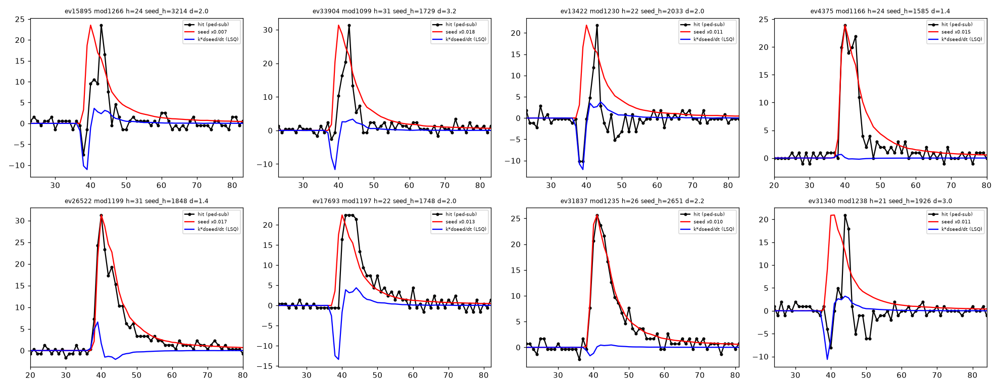

**Plotted.** Eight bad hits at 20–50 ADC drawn at random from the 3.49 GeV split (not selected by adjacency), against sample number (4 ns per sample):
- black: the pedestal-subtracted hit;
- red: the seed waveform scaled by h/seed_h;
- blue: the least-squares fit of k·dS/dt, the seed derivative (a capacitive coupling).

The titles give the event, module, h, seed height and distance d in mu.

**What to see.** Five of the eight (ev15895, ev33904, ev13422, ev17693, ev31340) peak 2–3 samples after the seed. Four of these five show a dip at the seed's rising edge and a short undershoot; ev17693 is late with a flat top and no dip. The other three (ev4375, ev26522, ev31837) are in time and follow the scaled seed roughly: these are normal-shaped bad hits. The derivative fit reproduces the dip in some of the late hits, but it never reproduces the positive peak.

**Meaning.** A random draw of bad hits shows both populations side by side. The late, narrow pulse is not a pure undelayed derivative of the seed, so a simple capacitive coupling is ruled out. Over 6,000 bad hits, the derivative model fits better than a scaled, shifted copy of the seed in only 10 % of cases (`tables/q56_wave.txt`).

## 2. Where and when

### 2.1 Bad fraction vs distance, timing and cluster membership

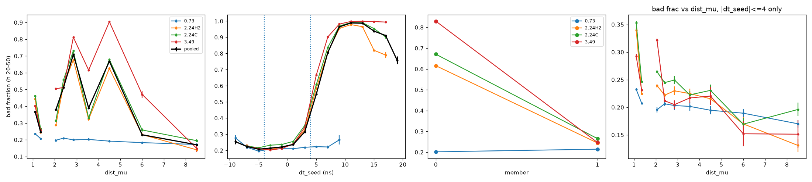

**Plotted.** Bad fraction of 20–50 ADC hits, per split and pooled (black, first two panels only), against four quantities, from left to right:
1. distance from the seed, in non-uniform bins at the module-lattice distances;
2. dt_seed, with the cluster time gate of ±4 ns shown as dotted lines;
3. cluster membership (0 = not in the cluster, 1 = member);
4. distance again, for in-time hits only (|dt_seed| ≤ 4 ns).

**What to see.**
- **Distance.** Pooled, the bad fraction jumps to 0.71 at 2.6–3.1 mu and 0.67 at 4–5 mu, with a dip to 0.39 between them; at 3.49 GeV it reaches 0.81 and 0.90. At 0.73 GeV it is flat at about 0.2.
- **Timing.** Inside the gate the bad fraction is flat at about 0.21. It rises steeply above +4 ns and is close to 1 at +9 to +17 ns.
- **Membership.** Non-members are bad in 0.62 (2.24 GeV H2), 0.67 (C) and 0.83 (3.49 GeV) of cases; at 0.73 GeV the figure is 0.20. Members are bad in 0.21–0.27 of cases in every split.
- **In-time hits.** With only in-time hits, the peaks vanish: the bad fraction falls overall from about 0.2–0.35 near the seed to about 0.15–0.2 at 6–8 mu.

**Meaning.** The excess of bad fits sits at specific distances, late in time, and outside the cluster. That pattern fits a delayed electronic coupling between particular channel pairs; a property of the hit's own shower would not produce it. The cluster gate already removes this crosstalk from the clusters. What remains in time (about 0.2–0.25 bad) is mostly the normal-shaped population, and it is present at every beam energy.

### 2.2 Bad and bipolar fractions vs seed height

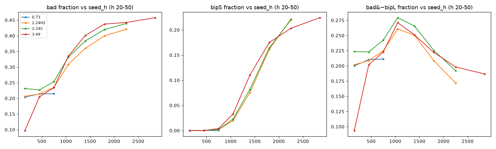

**Plotted.** Fractions of all 20–50 ADC hits in bins of seed height, per split: bad (left), strict bipolar (middle), and bad but not loose-bipolar (right).

**What to see.**
- **Bad.** The bad fraction rises from about 0.2 at seeds below 900 ADC to 0.42–0.46 above 2000 ADC. The 0.73 GeV split has no seed above about 900 ADC and stays flat at 0.21.
- **Strict bipolar.** This fraction is zero below about 750 ADC, then rises to 0.20–0.22 at 2000–2500 ADC. The three higher-energy splits lie on one curve.
- **Bad, not loose-bipolar.** This fraction rises to 0.26–0.28 around 1000 ADC and falls to 0.17–0.20 at the largest seeds. The lowest seed bin at 3.49 GeV is low in both the left and right panels (about 0.10).

**Meaning.** The crosstalk turns on above a seed-height threshold and then follows the seed height, the same way in every split. A coupling of about 1 % needs a seed of order 1000–2000 ADC to put a 20–50 ADC spike into another channel. The fall of the right-hand curve at large seeds is probably dilution: there, crosstalk hits make up a growing share of all hits (22 % at 2000–2500 ADC).

### 2.3 Same slot vs adjacent channel, by distance

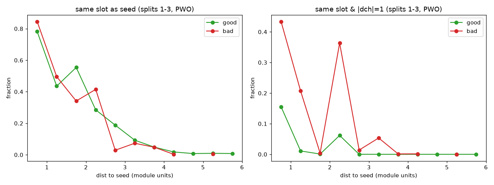

**Plotted.** Splits 25228, 25308 and 24386 (the 0.73 GeV split is excluded), PbWO4 hit and seed modules, 20–50 ADC. Left: the fraction of good (green) and bad (red) hits whose FADC slot is the seed's slot, in 0.5-mu distance bins. Right: the fraction whose channel is also adjacent to the seed's channel.

**What to see.** On the left, good and bad hits share the same overall fall with distance, with bin-to-bin differences in both directions: hits near the seed often share its slot, whatever their fit quality. On the right, bad hits are far more often on the adjacent channel: 0.43 against 0.16 in the nearest bin, 0.21 against 0.01 in the next, and 0.36 against 0.06 at 2.0–2.5 mu.

**Meaning.** Sharing a board with the seed does not make a fit bad; the Mantel–Haenszel odds ratio is 1.21 for same slot without adjacency. Being on the neighbouring channel does: the odds ratio is 4.8, and 3.4–6.0 across other stratifications (`tables/q24_b_slot.txt`, `q24_d_matched.txt`). Since a slot covers a compact 4 × 9 module strip, adjacent channels are also often spatial neighbours. The study separates the two effects with the stratified odds ratios and the "adjacent channel, spatially far" pairs of section 3.

### 2.4 Per-module bad fraction

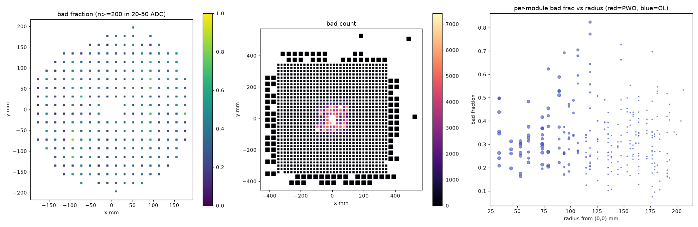

**Plotted.** Left: bad fraction per module at 20–50 ADC, all splits pooled, for the 264 modules with at least 200 hits, at their (x, y) positions in mm. Middle: the number of bad hits per module over the whole calorimeter; lead-glass modules are drawn as larger squares. Right: the per-module bad fraction against the module's distance from the beam axis, with marker size growing with the number of hits.

**What to see.**
- The bad hits sit in the central ±100 mm, where occupancy is highest.
- The module-to-module spread is large: 0.16 / 0.31 / 0.56 at the 5th / 50th / 95th percentiles. That is far beyond statistics (weighted standard deviation 0.133 against 0.008 expected).
- The two worst modules, W693 (0.82) and W464 (0.77), lie about 120 mm from the axis and are point-symmetric about the beam.
- The bad fraction has no simple trend with radius.

The red/blue key in the right panel's title does not apply: all 264 modules are PbWO4 and are drawn blue (a plotting artefact).

**Meaning.** Bad fits follow occupancy overall (the top 50 modules hold 67 % of bad hits and 64 % of all hits). On top of that, some modules are much worse than their neighbours. Module identity explains more of the spread than radius or slot does (weighted R² 0.513, against 0.393 with slot; `tables/q24_c_modules.txt`). This agrees with crosstalk on specific wiring paths.

### 2.5 Per-module bad fraction by split

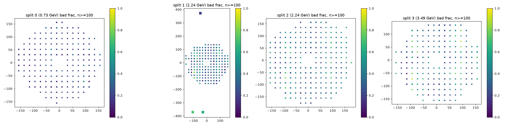

**Plotted.** The same per-module bad fraction as in section 2.4, computed per split for modules with at least 100 hits. Split 0 is 24590 (0.73 GeV), split 1 is 25228 (2.24 GeV H2), split 2 is 25308 (2.24 GeV C), and split 3 is 24386 (3.49 GeV). The colour scale is the same in every panel (0–1). The split 1 panel includes three lead-glass modules near y = ±370 mm (large squares), which stretch its axes.

**What to see.** At 0.73 GeV almost every module is dark (bad fraction about 0.1–0.3). At 2.24 and 3.49 GeV more modules are bright, and the bright ones are largely the same modules in each split.

**Meaning.** The per-module pattern is a stable property of position and wiring once seeds are large enough to cause crosstalk. The per-module bad fraction correlates between the 2.24 and 3.49 GeV splits with Pearson 0.87–0.96, but only 0.21–0.34 against 0.73 GeV.

## 3. Coupling

### 3.1 Coupling coefficient on adjacent-channel, spatially far pairs

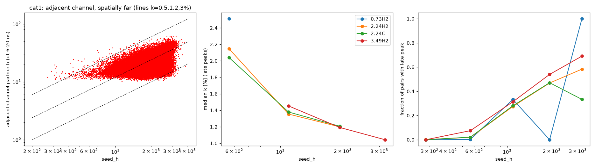

**Plotted.** For each event, the seed's two adjacent channels are taken from the per-event channel table, whose WA peaks reach down to about 10 ADC. Only pairs that are adjacent in channel but more than 1.5 mu apart in space are used, so shower leakage plays no part. A "late peak" is a detected peak at dt = 6–20 ns, and k = h / seed_h for that peak.
- Left: h against seed height for late peaks (log–log, up to 60,000 points), with lines at k = 0.5 %, 1.2 % and 3 %.
- Middle: the median k per split, shown when more than 20 late peaks are in the bin.
- Right: the fraction of pairs that have a late peak.

**What to see.** The points follow the 1.2 % line at large seeds. The lower edge of the cloud is the 10 ADC detection floor, not the coupling. The median k is the same in the three splits that reach the range: 1.35–1.45 % around 1100 ADC, 1.2 % around 1900 ADC, and 1.04 % at 2500–4100 ADC (3.49 GeV only). The late-peak fraction rises from nearly 0 below 400 ADC to 0.47–0.54 around 1900 ADC and up to 0.69 at 3.49 GeV.

The 2.0–2.5 % values at about 600 ADC are threshold-dominated: there, a 10 ADC peak already means k ≥ 1.8 %. The 0.73 GeV points above 800 ADC rest on 0–3 pairs (`tables/w2_t2c.txt`) and should be ignored.

**Meaning.** The adjacent-channel coupling is about 1.0–1.4 % of the seed height, and it is the same at every beam energy where it can be measured. Only 28–69 % of pairs (seed 800–4100 ADC) show a late peak, and k is measured only on those, so the slow fall of k with seed height is consistent with the detection floor removing low-k pairs at small seeds. The cross-crate coupling, which accounts for most bipolar hits, was not measured.

### 3.2 Timing of partner peaks

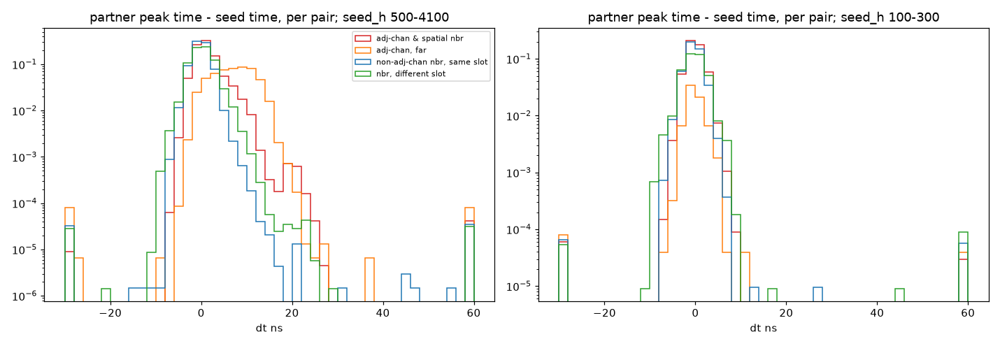

**Plotted.** Partner peak time minus seed peak time, per seed–partner pair, all splits pooled. Each histogram is normalized to the number of pairs in its category, including pairs with no detected peak. Left: seeds of 500–4100 ADC. Right: seeds of 100–300 ADC. The four categories are:
- red: adjacent channel and spatial neighbour;
- orange: adjacent channel, spatially far;
- blue: same-slot spatial neighbour on a non-adjacent channel;
- green: spatial neighbour on a different slot.

The bins at −30 and +60 ns hold the under- and overflow.

**What to see.** With large seeds, the adjacent-channel, spatially far pairs (orange) have a broad late component from about +4 to +20 ns, larger than their in-time peak. The adjacent-channel neighbours (red) show a smaller late shoulder on top of their in-time leakage. The two non-adjacent controls (blue, green) fall steeply after +4 ns, by two to three orders of magnitude by +10 ns. With small seeds, every category is in time and the late component is absent.

**Meaning.** The late signal belongs to the electronics neighbour (the adjacent channel), not to the geometric neighbour, and it needs a large seed. A fixed delay of order 10 ns that only appears above a seed-height threshold is what a coupling in the readout produces. Pile-up or late physics hits would not depend on channel adjacency in this way.

## 4. Amplitude dependence

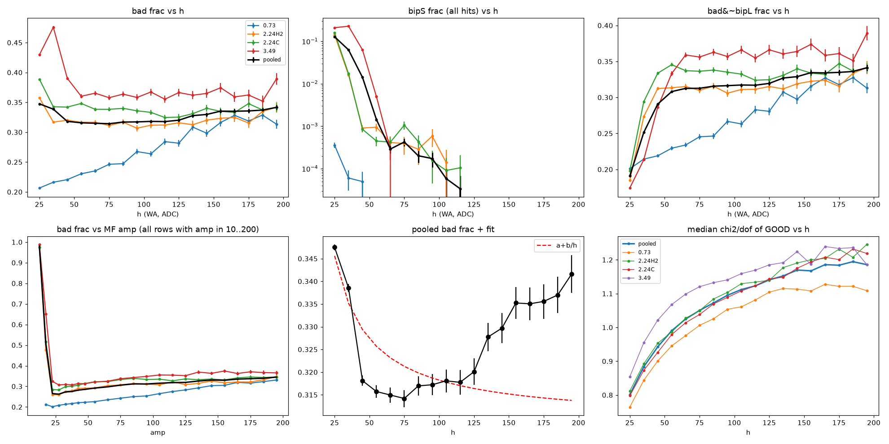

**Plotted.** Hits at 20–200 ADC in 10 ADC bins of h, per split and pooled (black). Note that the bottom-right panel uses its own colour assignment for the splits.
- Top left: bad fraction.
- Top middle: strict-bipolar fraction of all hits, on a log scale.
- Top right: fraction that is bad but not loose-bipolar.
- Bottom left: bad fraction against the MF amplitude instead of h, for all rows with MF amplitude of 10–200.
- Bottom middle: pooled bad fraction with a fit of a + b/h.
- Bottom right: median χ²/dof of the good fits.

**What to see.**
- **Bad fraction.** Pooled, it falls from 0.347 at 20–30 ADC to about 0.315 at 50–120 ADC, then rises to 0.342 at 190–200 ADC. At 3.49 GeV the low-h bins are high (0.43–0.48), then the curve settles near 0.36. At 0.73 GeV it rises steadily from 0.21 to about 0.33.
- **Strict bipolar.** This fraction drops from 12.8 % (20–30 ADC) to 6.3 %, 1.4 % and 0.14 % (50–60 ADC), and to below 0.05 % above 60 ADC.
- **Bad, not loose-bipolar.** This rises from 0.19 to about 0.31 by 50–60 ADC and then climbs slowly to 0.34.
- **Against MF amplitude.** Rows with MF amplitude 10–15 are 98 % bad. Their MF amplitude is well below h (h ≥ 20), which matches the crosstalk amp/h deficit of section 1.2.
- **Fit.** The a + b/h fit (a = 0.309, b = 0.91) does not describe the data: χ²/n = 26. The data fall faster than 1/h below 50 ADC and rise again above about 120 ADC.
- **Good fits.** Their median χ²/dof rises with h in every split, from 0.80 at 20–30 ADC to about 1.19 at 190–200 ADC pooled.

**Meaning.** The crosstalk population is confined to small pulses. It is what a coupling of about 1 % applied to seeds of at most about 4000 ADC can produce. The bad fits that remain above 60 ADC are normal-shaped, and their share grows slowly with amplitude. So does the χ² of the good fits. That is the expected signature of a noise model whose amplitude-proportional term is too small, or of a template mismatch that grows with amplitude. This explanation is inferred; a refit with a larger model term would test it.

## Takeaways

- About a quarter of the bad MF fits at 20–50 ADC are crosstalk: a narrow bipolar spike about 12 ns after a large seed, with a coupling of about 1.0–1.4 % on adjacent channels. These spikes vanish above about 60 ADC and are absent at 0.73 GeV.
- The crosstalk follows electronics paths, not geometry. It appears on the seed's adjacent FADC channel and on a few cross-crate slot pairs. The cross-crate path and its coupling are not identified.
- Crosstalk arrives outside the 4 ns cluster gate, so it almost never enters clusters (bipolar members carry about 5 × 10⁻⁶ of the cluster energy).
- Most bad fits (about 55–60 % at 20–50 ADC, and nearly all above 60 ADC) are normal-shaped, in-time cluster members with correct MF amplitude. The likely cause is the noise model's 3 % term or a template mismatch; this is untested.
- Do not reject hits on MF χ². That would throw away about 1 % of cluster energy at 20–50 ADC and 3–5 % at 50–200 ADC (`tables/q56_energy.txt`).
- Coverage: 4 of the 28 splits, no Ta runs. The waveform-model fits use the 3.49 GeV split only.
