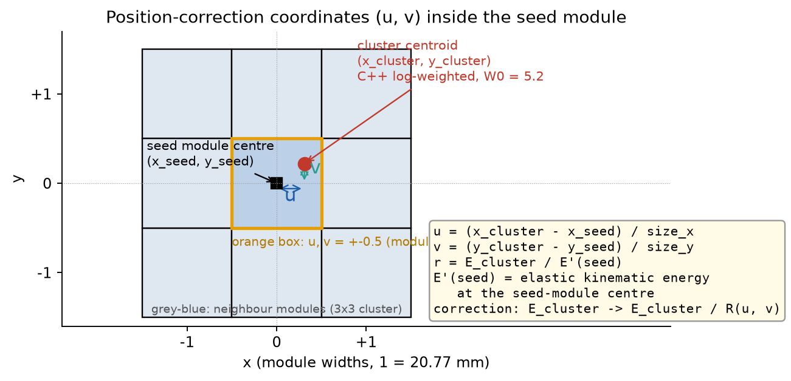
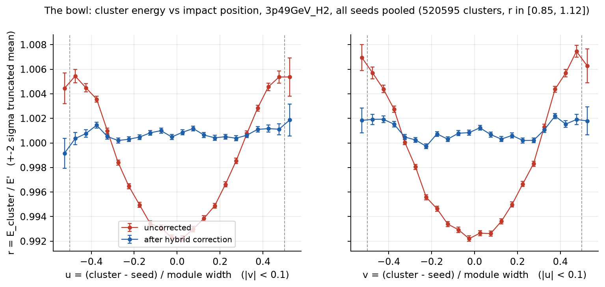
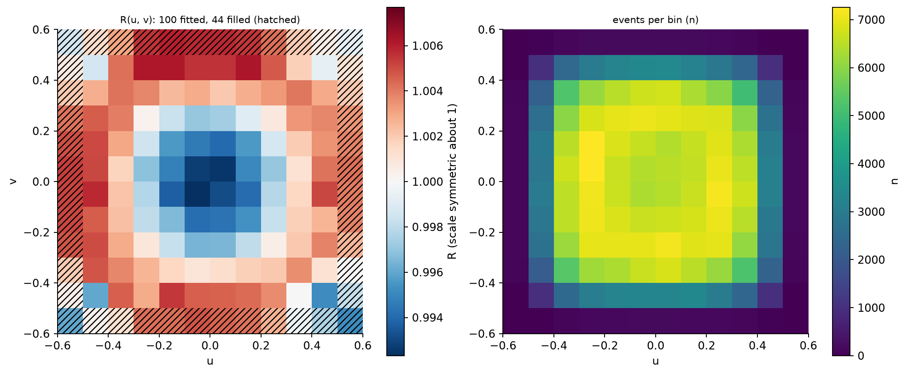
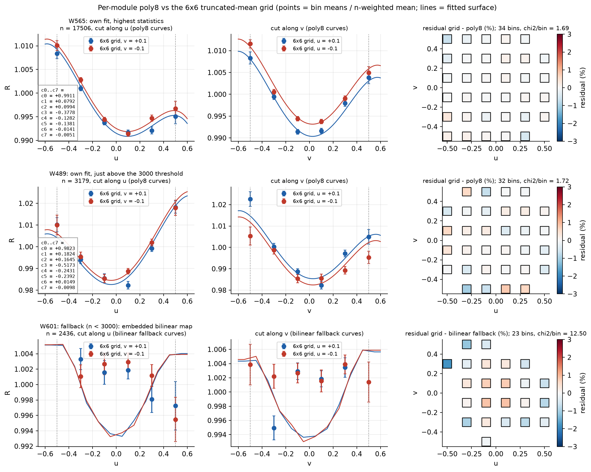
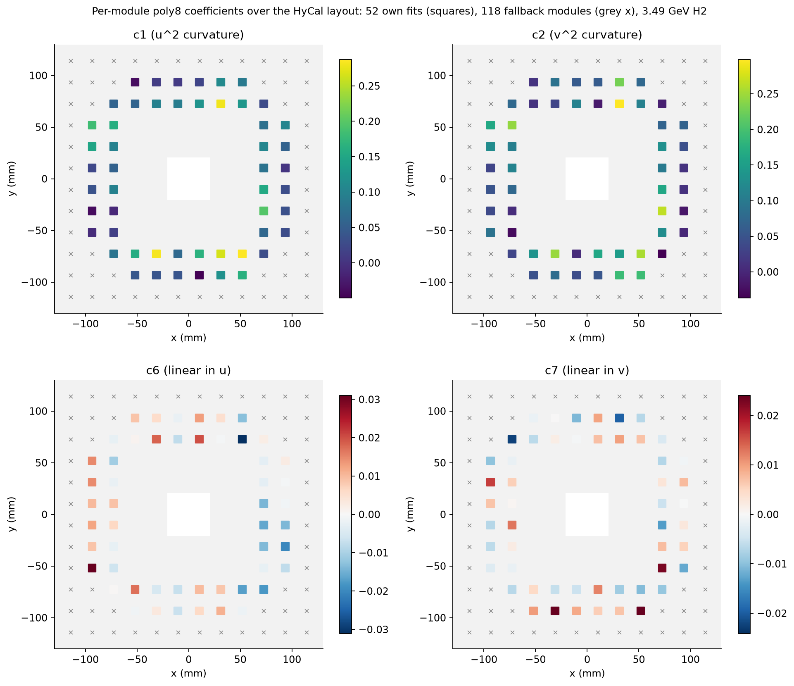
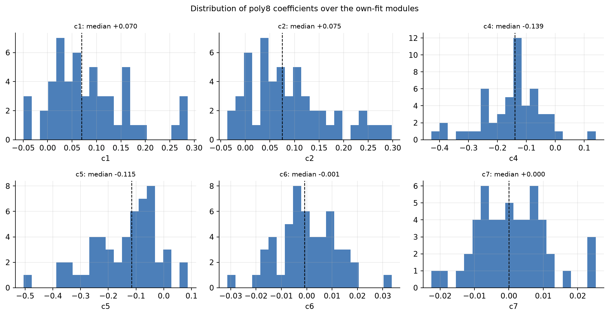
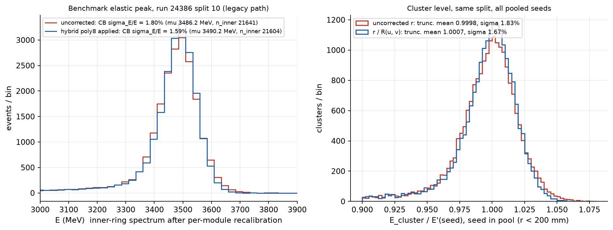
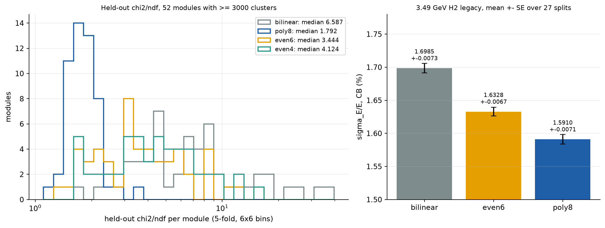

# Position-dependent cluster-energy correction: algorithm, scripts, figures

**Date:** 2026-11-05
**Context:** the r5ri chain (`output/r5ri_20261104/`, runinfo calibration) at 3.49 GeV H2, runs 24386/24503/24512. Form study: `output/poscorr_form_20261105/`.
**Source of the numbers:** `notes/figures/poscorr_20261105/facts.md` (machine-readable: `facts_data.json`). Figures made by `poscorr_explain_plots.py`; nothing in `output/` was changed.

Conventions: paths are relative to `analysis/pyscripts/` unless noted; `prad2det/`, `docs/` and `database/` are relative to the repository root. Line numbers are as of 2026-11-05 and drift with edits; "~" marks an approximate range. **B** = `benchmark_hycal_timing_test_20261021.py` (frozen, sha1 `3293ab96…`). σ_E/E is the Crystal Ball (CB) width of the inner-ring elastic peak on the legacy path.

## 1. Purpose and summary

The energy of an elastic cluster depends on where the electron hit the seed crystal: a cluster centred on the crystal reads about 0.5–0.8 % lower than one near an edge, and the size of the effect differs from crystal to crystal. The correction divides each cluster energy by a function R(u, v) of the impact position inside the seed module, so that the mean E/E′ no longer depends on position. R is built once per run type from the map-stage scan of the chain, stored as JSON, and applied by the frozen benchmark after the per-crystal gains, through `--pos-corr`. For 3.49 GeV H2 the form in use is a hybrid: a per-module eight-coefficient polynomial (poly8) for the 52 seed modules with enough clusters, and a pooled 12 × 12 bilinear map for the other 118. On run 24386 split 10 it narrows σ_E/E from 1.80 % to 1.59 % (in-sample: the map was fitted on splits that include this one). The held-out form study of 2026-11-05 confirms the per-module polynomial over the pooled map (section 7).

## 2. Definitions



**Figure 1.** Schematic of the variables. The impact position is measured from the seed-module centre in units of the module size; r is the cluster energy over the expected elastic energy; the correction divides by R(u, v).

- **u, v**: u = (x_cluster − x_seed) / size_x and v = (y_cluster − y_seed) / size_y, with the PbWO4 pitch size_x = 20.77 mm and size_y = 20.75 mm (`database/hycal_map.json`, W1 `sx`, `sy`). v divides by size_y, not size_x (`position_corr.py` `load_pool`, `sy`); the difference is 0.1 %. The module centre is u = v = 0 and the edges are at ±0.5.
- **x_seed, y_seed**: the centre of the seed module (the highest-energy crystal of the cluster).
- **x_cluster, y_cluster**: the log-weighted centroid of the C++ reconstruction (`prad2det/src/HyCalCluster.cpp` `reconstruct_pos`, ~:412-453). Each of the seed and its 3 × 3 neighbours enters with weight max(0, W0 + ln(E_i/E_cluster)) (`get_weight`, :481); W0 = `log_weight_thres` = 5.2 (`output/r5_20261028/configs/reconstruction_config_r5.json:33`). Crystals below e^−5.2 ≈ 0.55 % of the cluster energy get zero weight.
- **r** = E_cluster / E′, where E_cluster is the gain-corrected cluster energy and E′ the expected elastic energy at the seed module (`result_window.tsv`, `eprime_MeV`).
- **R(u, v)**: the fitted position dependence of r, normalised to a mean of 1. The corrected energy is E_cluster / R(u, v).

The training pool (`position_corr.py` `load_pool`): legacy-path clusters with the seed inside r_seed < 200 mm, seeds in the 6 × 6 block of rows 15–20 and columns 15–20 (1-based) around the beam hole excluded, seed energy at or above the run's `min_seed`, Møller-flagged clusters dropped. For 3.49 GeV H2: 27 splits, 520 595 clusters with r in [0.85, 1.12].

## 3. The observed effect



**Figure 2.** Truncated mean (±2σ) of r in 24 bins of u (left, |v| < 0.1) and of v (right, |u| < 0.1), 3.49 GeV H2 pool, gains applied, no position correction (points) and after the hybrid correction (line). Error bars are σ/√n.

Uncorrected, r is lowest at the module centre (0.9922–0.9927 in the central bins) and rises to about 1.0055 at u = ±0.47 and 1.0069–1.0075 at v = ±0.48: a bowl 0.5–0.8 % deep. After the correction the profile is flat within about ±0.1 % around 1.0005–1.001; the residual offset is the map normalisation (bilinear norm 1.0007).



**Figure 2b.** The pooled bilinear map of 3.49 GeV H2 (`poscorr_r5ri_bilinear_3p49GeV_H2_all.json`): fitted R per (u, v) bin, colour scale symmetric about 1 (±0.0072). Hatched bins had fewer than 300 clusters and were filled from their neighbours.

The pooled map is a bowl in both directions: fitted R ranges from 0.9923 to 1.0063, the central 2 × 2 bins average 0.9927, the median bin uncertainty is 0.00043. Of the 144 bins, 100 were fitted (969 to 7253 clusters each) and 44 were filled, all on the outer ring beyond |u| or |v| = 0.5, where clusters whose centroid falls outside the seed module are rare.

Single modules deviate from the pool by more than this. Among the modules with their own fit (section 4b), W565 spans R ≈ 0.991–1.011 along the cuts of figure 3 and W489 spans 0.982–1.02, a centre-to-edge rise of about 2 % (`facts.md`, fig03). The pooled map cannot describe such a module, which is why the per-module fit exists.

## 4. Algorithm as currently run

### 4a. Per-run-type bilinear map (`position_corr.py map`, then `fit --form bilinear`)

1. Pool the clusters of all runs of one run type (section 2) and bin them in 12 × 12 bins of (u, v) over [−0.6, 0.6]² (bin width 0.1; `--bins 12`, `--range 0.6`).
2. In each bin with at least 300 clusters (`--min-n 300`), fit the peak of r in the window [0.85, 1.12] (`R_LO`, `R_HI`, :89) with the run type's preferred fitter. That is CB for 3.49 GeV H2, 2.24 GeV C and Ta, and the ±2σ iterative Gaussian for 2.24 and 0.73 GeV H2 (`gate_scan_20261022.py:141` `R_PREF`); a majority vote of the splits' own `preferred_fit` overrides it when present (`cmd_map`). The peak position is the bin's R; its standard error comes from 30 bootstrap refits (`--boot 30`).
3. Fill the bins below `min_n` with the mean of their populated 8-neighbours, repeated until the grid is full (`fill_neighbours`, :554). Filled bins carry the largest standard error of the fitted ones.
4. Normalise so that the mean of R over all 144 bins, weighted by their cluster counts, is 1 (`fill_grid`, :575; norm 1.000712 for 3.49 GeV H2) and write the `poscorr_v1` JSON.
5. At application (B `poscorr_eval`, ~:733-745): clip u and v to the range of the bin centres (±0.55) and interpolate bilinearly between the four surrounding bin centres. Clusters outside ±0.6 are counted as clamped.

Chain gate (`output/r5ri_20261104/tools/chain_ri.sh`, G4): the norm within 0.02 of 1 and at least 90 % of the bins holding any cluster (97 % for 3.49 GeV H2), for every bilinear JSON.

### 4b. Hybrid: per-module poly8 with bilinear fallback (`fit --per-module`)



**Figure 3.** Three seed modules of 3.49 GeV H2. Left: the 6 × 6 truncated-mean grid (points, divided by the cluster-weighted mean of the bin means) and the fitted surface along v = ±0.1 (top) and u = ±0.1 (bottom). Right: residual grid minus fit, in %. W565 (n = 17 506, the module with most clusters) and W489 (n = 3179, just above the threshold) have their own fit; W601 (n = 2436) falls back to the pooled bilinear map, which is what the lines show there.

For each seed module with at least 3000 clusters in the r window [0.85, 1.12] (`--min-clusters 3000`, :1067; `HYB_RMIN/RMAX`, :785):

1. Bin the clusters in a 6 × 6 grid over [−0.6, 0.6]² (`HYB_GRID`, clamp 0.6). A bin with at least 30 clusters (`HYB_MIN_BIN`) contributes its iterative ±2σ truncated mean (`trunc_mean`, `HYB_TRUNC_K` = 2) and standard error; at least 10 bins are needed (`HYB_MIN_BINS`).
2. Fit the bin means by weighted least squares, minimising Σ((mean_i − R)/se_i)² (`fit_poly8_bins`, :880), to the PRad-I form (`poly_R`, ~:795-803):

   R(u, v) = c0 (1 + c1 u² + c2 v² + c3 u² v² + c4 u⁴ + c5 v⁴ + c6 u + c7 v).

3. Rescale c0 so that the mean of R over the module's own clusters is 1 (`normalise`, :891).
4. Accept the fit only if R stays within [0.9, 1.1] on a 13 × 13 grid over the clamp square (`HYB_RANGE`, `range_ok`); otherwise the module falls back to the map. No eligible fit failed for 3.49 GeV H2 (`stats.failed` empty).
5. Store the eight coefficients per module with the embedded bilinear map as fallback (`poscorr_hybrid_v1` JSON, and a `_modules.tsv` with one row per seeding module).

At application (B `poscorr_eval`, :696-715) a cluster whose seed has its own fit gets R from its polynomial with u, v clipped to ±0.6; every other cluster gets the bilinear fallback of 4a. For 3.49 GeV H2: 170 seeding modules, 52 own fits (30.6 % of modules, 78.2 % of clusters), 118 fallback. On 24386 split 10 the benchmark log reads `n_applied=154933 n_clamped=17 n_own=34889 own_modules=52` (`n_applied` counts every cluster of both paths, a larger set than the training pool, so the own share differs from 78.2 %).

Why the linear terms: the island is 4-connected and asymmetric around the seed, so the energy response is not even in u and v; c6 and c7 absorb this (`plans/plan_20261023.md:189`). The even terms carry the bowl. Section 7 quantifies both.



**Figure 4.** Coefficients c1, c2 (curvature) and c6, c7 (linear) of the 52 own fits at their module positions (squares); grey crosses are the 118 fallback modules. Only the seed ring around the beam hole appears, because the pool keeps seeds with r_seed < 200 mm and excludes the 6 × 6 block of rows and columns 15–20 (white).

Over the 52 fits the curvature terms c1 and c2 are each positive in 47, both in 42 (c1 median 0.0697, range −0.049 to 0.287; c2 median 0.0751, range −0.036 to 0.298) and larger in the top and bottom rows. The quartic terms are mostly negative (c4 < 0 in 50 fits, median −0.139; c5 < 0 in 48, median −0.115). The linear terms scatter around zero within ±0.03 (c6 median −0.0008, c7 median 0.00004).



**Figure 4b.** Distribution of c0 to c7 over the 52 own fits.

### 4c. Which form for which run type

`chain_ri.sh` (~:44-48) builds the bilinear map for every e-p and C run type and the hybrid on top of it for 3.49 GeV H2, 2.24 GeV H2 and 2.24 GeV C. The 0.73 GeV H2 file is a symlink to its bilinear map; the Ta (X17) file is a symlink to the 2.24 GeV H2 bilinear map, since Ta has no map of its own.

### 4d. Application in the benchmark

B loads the JSON (`poscorr_load`, :653-681) and applies it in the calibration block (:3248-3290) after the per-crystal gain table and before the Møller rejection and the elastic-window pass. For every event record of both cluster paths, u and v are formed from the stored centroid and seed centre over the seed module size, and the cluster energy (tuple field 6) is replaced by E/R (:3278). Only the cluster energy changes; member energies and positions are untouched. The header of `result.tsv` records `# pos_corr=<path> sha1=… form=… norm=… n_applied=… n_clamped=…` plus `n_own` and `own_modules` for a hybrid file.

### 4e. JSON schemas

`poscorr_v1` (bilinear): `schema`, `form`, `run_type`, `slug`, `u_edges`, `v_edges` (13 each), `R`, `n`, `se`, `filled` (12 × 12 each), `norm`, `poly` (null for bilinear), `source` (scan_dir, splits, set, path, fit, n_events, map_tsv), `created`, `git`.

`poscorr_hybrid_v1`: `schema`, `form` = hybrid, `run_type`, `slug`, `module_form` = poly8, `clamp`, `min_clusters`, `fallback` (a full `poscorr_v1` object), `fallback_path`, `fallback_sha1`, `modules` (name → `id`, `n`, `c[8]`, `L_e`, `L_c`: edge and corner lift in %), `stats` (seeding_modules, eligible, own, own_frac_modules, own_frac_events, n_events, failed), `estimator` (grid, min_bin, trunc_k, r_range, min_bins, range_check, norm), `source`, `created`, `git`.

## 5. Scripts and commands

| Script | Role |
|---|---|
| `output/r5ri_20261104/tools/ri_jobs.py` | Writes the job lists `jobs/{dump,map,final,repro}.txt` from `r5_jobs.py --dry-run`, with runinfo calibration files (`calib_resolve.py`) |
| `output/r5ri_20261104/tools/chain_ri.sh` | Runs the stages dump → gains → map → maps → final → repro with gates G2–G6; `STAGES` selects stages |
| `output/r5ri_20261104/tools/run1_ri.sh`, `run1.sh` | Run one benchmark job; `run1_ri.sh` checks the benchmark sha1 |
| `output/merge_check_20261028/tools/merge_cfg_wrap.py` | Wrapper that imports the frozen benchmark with the r5 reconstruction config |
| `benchmark_hycal_timing_test_20261021.py` (B) | Reconstruction and calibration; `--write-cluster-tsv` writes the cluster pool, `--pos-corr FILE` applies a map |
| `percrystal_calib.py` | Per-crystal gains (gains stage), input to the map scan, not part of the correction itself |
| `position_corr.py` | `map`: per-bin fits and `map_<slug>_all.tsv`; `fit --form bilinear`: `poscorr_v1` JSON; `fit --per-module`: `poscorr_hybrid_v1` JSON |
| `plot_module_resolution.py` | Loaders and geometry used by `position_corr.py` (`load_run`, `load_geometry`) |
| `gate_scan_20261022.py` | Run-type slugs, `R_PREF`, `git_info` |
| `compare_scan_dirs.py` | Paired per-split σ_E/E comparison between scan directories (form study, `post.sh`) |
| `output/poscorr_form_20261105/tools/heldout.py`, `sigma_table.py` | Form study: 5-fold held-out χ² per module; σ_E/E table |
| `poscorr_explain_plots.py` | The figures of this note |

Commands in order (from `analysis/pyscripts`, after `source setup_env.sh`):

```bash
python3 output/r5ri_20261104/tools/ri_jobs.py --chain r5ri          # job lists
bash output/r5ri_20261104/tools/chain_ri.sh r5ri                     # all stages; STAGES="map maps final" for the correction only
```

Map-stage job (`jobs/map.txt:1`, first token is the job directory; identical to the final job below except for the output stem and no `--pos-corr`), then the maps stage (`chain_ri.sh`; S = `output/r5ri_20261104/poscorr/scan`, M = `output/r5ri_20261104/poscorr/maps`):

```bash
python3 position_corr.py map --scan-dir $S --out $M --splits all --workers 4
python3 position_corr.py fit --map $M/map_${s}_all.tsv --form bilinear --out $M/$s/poscorr_r5ri_bilinear_${s}_all.json     # s in 3p49GeV_H2 2p24GeV_H2 2p24GeV_C 0p73GeV_H2
python3 position_corr.py fit --per-module --scan-dir $S --splits all --slug $s --fallback $M/$s/poscorr_r5ri_bilinear_${s}_all.json --out $M/$s/poscorr_r5ri_${s}_all.json     # s in 3p49GeV_H2 2p24GeV_H2 2p24GeV_C
```

Final job (`jobs/final.txt:1`, `Commands.md`):

```bash
output/r5ri_20261104/scan/splits/scan_024386/split_00010 /Users/L00338853/Software/opt/miniforge3/bin/python3 /Users/L00338853/work/PRad/prad2evviewer/analysis/pyscripts/output/merge_check_20261028/tools/merge_cfg_wrap.py --hycal-cfg output/r5_20261028/configs/reconstruction_config_r5.json /Users/L00338853/work/PRad/data/evio/prad_024386.evio.00010 output/r5ri_20261104/scan/splits/scan_024386/split_00010/result --calibrate --exclude-rowcol 15 20 15 20 --pre-window 100.0 200.0 --inner-radius 200 --min-per-module 30 --lms-corr off --hc-calib-file /Users/L00338853/work/PRad/prad2evviewer/database/calibration/calibration_factor_3p5_June7_nonLinear.json --window 16.0 --time-calib off --pulse-method mf --mf-scale 1.01 --mf-r-model 0.3 --mf-templates output/templates_spline_best50_20261026/3p49GeV_H2/templates_3p49GeV_H2.npz --mf-scale 1.0 --gain-file output/r5ri_20261104/gains/024386/gains_024386_all.tsv --pos-corr output/r5ri_20261104/poscorr/maps/3p49GeV_H2/poscorr_r5ri_3p49GeV_H2_all.json --write-cluster-tsv --moller-reject kin --moller-kin-n 3 --moller-kin-m 2 --moller-reject-gains on --fit-select chi2 --cb-two-peak --cluster-profile geant4 --gain-refine off --nl-members on
```

Figures of this note:

```bash
python3 poscorr_explain_plots.py --run-type 3p49GeV_H2 --out notes/figures/poscorr_20261105
```

## 6. Constants

| Constant | Value | Where | Rationale on record |
|---|---|---|---|
| r window of the pool and fits | [0.85, 1.12] | `position_corr.py:89` (`R_LO`, `R_HI`), :785 (`HYB_RMIN/RMAX`) | fit range of r = E_cal/E′ (code comment) |
| Map bins | 12 × 12 | `position_corr.py:1039` | **none recorded** |
| Map range | ±0.6 | `position_corr.py:1040` | not recorded |
| Map bin minimum | 300 clusters | `position_corr.py:1041` | not recorded |
| Bootstrap refits | 30 | `position_corr.py` ~:1045 | not recorded |
| Per-bin fitter | CB / Gaussian by run type | `gate_scan_20261022.py:141` `R_PREF` | plan_20261021 §3.5, user decision (code comment) |
| Own-fit threshold | 3000 clusters | `position_corr.py:1067` | **none recorded** |
| Clamp | 0.6 | `position_corr.py:1068` | **none recorded** |
| Module grid | 6 × 6 | `position_corr.py:786` `HYB_GRID` | **none recorded** |
| Grid bin minimum, bins needed | 30, 10 | :787-788 | not recorded |
| Accepted R range | [0.9, 1.1] | `position_corr.py:789` `HYB_RANGE` | **none recorded** |
| Truncation | ±2σ | `position_corr.py:790` `HYB_TRUNC_K` | not recorded |
| Fit weights | 1/se² | `position_corr.py:880` | not recorded |
| Centroid W0 | 5.2 | `reconstruction_config_r5.json:33` | reconstruction config |
| Pool acceptance | r_seed < 200 mm, 6 × 6 block rows and cols 15–20 out | `position_corr.py` defaults, benchmark flags | plan_20261025 Study A (reference pool) |

## 7. Validation and the form study



**Figure 5.** Run 24386 split 10. Left: the inner-ring recalibrated spectrum (`result.tsv`, legacy path) without `--pos-corr` (map-stage job) and with the hybrid map (final job); same gain file, same events. Right: cluster-level r for the same split (20 529 clusters in [0.85, 1.12]), uncorrected and divided by R.

The CB width goes from 1.80 % (σ 62.78 MeV, μ 3486.25 MeV, 21 641 inner-ring events, 119 modules) to 1.59 % (55.62 MeV, μ 3490.22 MeV, 21 604 events, 118 modules); the peak moves up by about 0.1 %. The cluster-level truncated σ goes from 1.83 % to 1.67 %. Both are in-sample: the map was fitted on the 27 splits that include this one. The module count and the event count differ slightly because the per-module event sampling changes with the correction.



**Figure 6.** Form study at 3.49 GeV H2 (`output/poscorr_form_20261105/`). Left: held-out χ²/ndf per module (5-fold, 52 modules with at least 3000 clusters) for the pooled bilinear map and for per-module poly8, even6 (c6 = c7 = 0) and even4 (c3 to c7 = 0). The bilinear map is the production one, not refitted per fold, so its χ² is optimistic. Right: σ_E/E over the 27 splits for the three forms run through the benchmark; each map was fitted on all 27 splits, so this panel is in-sample.

Held-out χ²/ndf medians: bilinear 6.587, poly8 1.792, even6 3.444, even4 4.124; poly8 is best in 49 of 52 modules. In the benchmark (CB, legacy, mean ± SE over 27 paired splits): poly8 1.5910 ± 0.0071 %, even6 1.6328 ± 0.0067 %, bilinear 1.6985 ± 0.0073 %; paired differences against poly8 are +0.1075 ± 0.0055 pp (bilinear) and +0.0418 ± 0.0037 pp (even6). The two linear terms carry about 40 % of poly8's gain over the pooled map. even4 was not run through the benchmark, having lost in the held-out test.

The fallback module of figure 3 shows the limit of the pooled map: W601 (2436 clusters) has χ² per bin 12.5 against the bilinear map (residual rms 0.68 %), whereas the own fits of W565 and W489 reach 1.69 and 1.72. Lowering the 3000 threshold would give such modules their own fit; its cost in fit stability has not been studied.

## 8. Decision history and open points

- **2026-10-23** (`plans/plan_20261023.md` §6.3, F4): a position correction E_corr = E_cal / R(u, v) after the per-crystal gains, global per run type; bilinear map as default, the PRad-I polynomial (`docs/analysis_notes/cluster_density_correction.md`) as alternative, the linear terms justified by the asymmetry of the 4-connected island.
- **2026-10-25** (`plans/plan_20261025.md:523-660`, Study B): six forms compared on even/odd halves of the training splits. The per-module poly8 with bilinear fallback (form d, threshold 3000) was selected over the held-out run-type map at 3.49 GeV H2, 2.24 GeV H2 and 2.24 GeV C; the modules differ beyond statistics.
- **2026-10-26** (`plans/plan_20261025.md:449`, Todo 28, user's go): the hybrid adopted as R3 at 3.49 GeV H2, 2.24 GeV H2 and C, bilinear at 0.73 GeV and Ta. At 0.73 GeV the hybrid had worsened σ_E/E in the full confirmation scan of 10-25 (`output/scan_20261025/pos_hybrid`, `plans/plan_20261025.md:436`, Todo 27).
- **2026-11-04/05** (`plans/plan_ri_20261104.md`, `chain_ri.sh`): the maps rebuilt on runinfo-calibrated gains in the r5ri chain; the JSONs of this note date from 2026-11-05 (`created`).
- **2026-11-05** (`output/poscorr_form_20261105/README.md`): form study at 3.49 GeV H2 only; `fit --per-module --form {poly8,even6,even4}` added to `position_corr.py` for it (default output unchanged; the refit reproduces the stored hybrid exactly).

Open points:

- The form study covers 3.49 GeV H2 only; 2.24 GeV H2, 2.24 GeV C and 0.73 GeV H2 are the next step (README of the study).
- Most constants in section 6 have no recorded rationale, among them the five in bold: the 3000-cluster threshold, the accepted range [0.9, 1.1], the clamp 0.6, the 12 × 12 map binning and the 6 × 6 module grid.
- The production maps are fitted on the same splits they are applied to, so every "after" number in this note is in-sample, except the held-out χ²/ndf of the per-module forms (figure 6, left).
- The 6 × 6 block around the beam hole (rows and columns 15–20) is excluded from the pool, so figure 4 shows only the seed ring; modules inside the rectangle receive no own fit and no map tailored to them.
