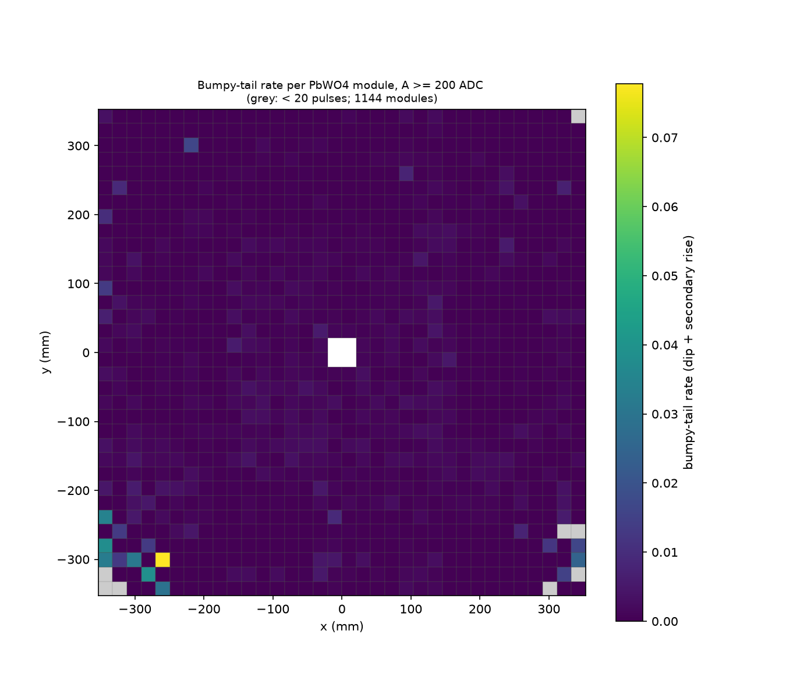
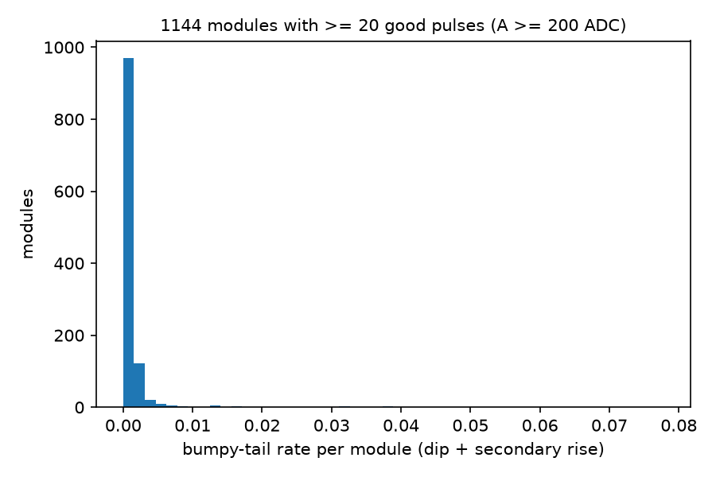
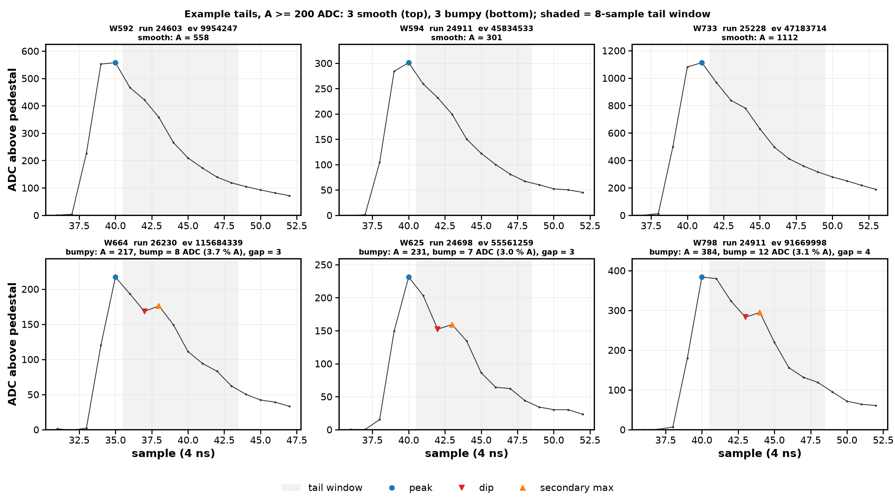
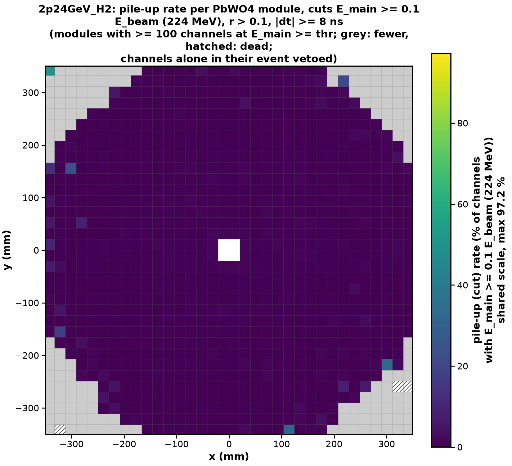
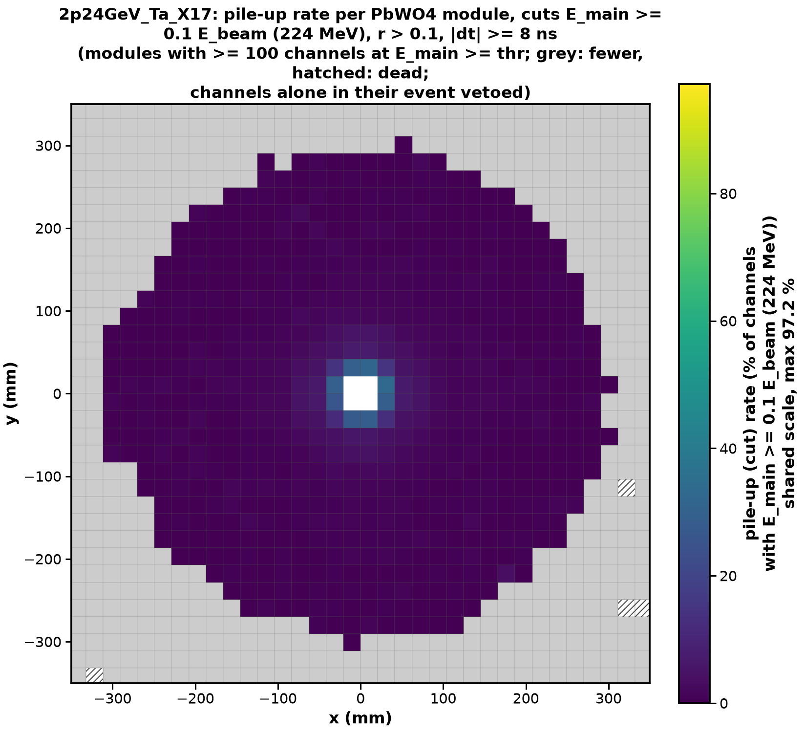

# PbWO4 descending-tail ("bumpy tail") study

Script: `waveform_analysis/pulse_shape_study.py`. Final results: `output/pulse_shape_study/`.
Scan of 2026-11-11. Internal technical note.

## 1 Purpose

Some PbWO4 pulses show a dip and a secondary rise on the falling edge shortly after the peak. This
study measures how often such "bumpy" tails occur in good production pulses, whether they
concentrate in particular modules, and what that means for the template extraction and the
matched filter, which both assume a smooth single-pulse shape. Section 7 adds the pile-up rate.

## 2 Data and selection

- 13 runs, 103 EVIO splits (`/Users/L00338853/work/PRad/data/evio`), the four run types of the
  template banks, pooled: 0.73 GeV H2 (24590, 24603), 2.24 GeV H2 (25228, 25257, 25260, 25299,
  25320), 3.49 GeV H2 (24698, 24911, 24937; these replace 24386, 24503 and 24512) and 2.24 GeV Ta
  X17 (25800, 26138, 26230). The run lists are those of `run_pulse_shape_scan.sh`.
- 14 965 153 events seen, 14 902 697 after the trigger gate, 2 vetoed by the light monitoring bit.
- Good pulse = the production `template_extract.py select` quality cuts: trigger gate of the run
  type, light monitoring system veto, at most 20 modules per event above 50 ADC, dead modules of
  the run (`runinfo/general.json`) skipped, no sample at 4095 ADC (clipping), A >= 50 ADC, peak at
  sample <= 59, first threshold crossing (2 ADC) at sample >= 20, pedestal root-mean-square
  noise <= 1.5 ADC and absolute pre-pulse slope <= 0.05 ADC per sample, tail back at baseline
  40-50 samples after the peak, no secondary rise >= 10 % of A, rough energy < 1.2 E_beam.
- The smoothness cut of the production selection (monotonic rising edge, no tail sample up by
  more than twice the pedestal noise; `smooth_cut = False` in `pulse_shape_study.py`) is not
  applied: the tail shape is what this study measures. No matched filter is run, so a pulse with a
  genuine second pulse close behind the peak is kept and counted as bumpy. PbWO4 modules only;
  samples are 4 ns; w = sample - WaveAnalyzer pedestal.

## 3 Tail classification

The tail window is the `TAIL_NSAMP = 8` samples after the peak (peak+1 .. peak+8), cut earlier
at the first sample with w < `TAIL_END_ADC = 2` (back at pedestal level).

- **bumpy**: a dip sample k in the window with w[k] < w[k-1], followed inside the window by a
  secondary maximum at least max(`BUMP_MIN_ADC` = 3 ADC, `BUMP_MIN_FRAC` = 3 % of A) above
  w[k]. With several qualifying dips the one with the largest rise is recorded.
- **plateau**: not bumpy, but the strictly descending run after the peak breaks within 8
  samples (a flat step followed by continued descent).
- **smooth**: otherwise.

A plateau carries no secondary rise, so it is reported separately and is not in the bumpy rate.
3 ADC alone (about 3 sigma of the ~0.9 ADC pedestal noise) is noise dominated once the whole tail
is searched; the 3 % of A floor and the 8-sample window remove the late-tail population
(section 6). The rate and all figures keep A >= `AMP_MIN` = 200 ADC, where a 3 % bump is at least
6 ADC. A hot module has rate > 10 % with n >= 20 pulses.

## 4 Results

| Quantity (A >= 200 ADC unless noted) | Count | Fraction |
|---|---:|---:|
| Good pulses, all A (1149 modules) | 41 435 832 | |
| Good pulses with A >= 200 ADC (1149 modules) | 16 785 764 | 40.51 % of all |
| smooth | 16 574 795 | 98.74 % |
| plateau (not in the rate) | 196 690 | 1.17 % |
| bumpy | 14 279 | 0.09 % |

Per module (1144 PbWO4 modules with >= 20 pulses at A >= 200 ADC): median bumpy rate 0.01 %,
90th percentile 0.21 %, 99th percentile 1.33 %; 566 modules have no bumpy pulse. Hot modules:
none (`hot_modules.tsv` and `hot_examples.pdf` are empty). Sixteen modules exceed 1 %: fourteen
of them sit in the two lower corners of the array with 26-90 pulses and 1-7 bumpy pulses (the
highest W1059, 7 of 90, 7.8 %), the other two are W75 (3 of 184, 1.6 %) and W409 (9 of 684,
1.3 %); the modules with the most pulses, W493 (738 029) and W494 (609 016), have 0.07 % and
0.02 %.

Dip position and peak-to-secondary-maximum gap of the 14 279 bumpy pulses (samples after the
peak); the secondary maximum follows the dip by one sample in most pulses:

| samples after peak | 1 | 2 | 3 | 4 | 5 | 6 | 7 | 8 |
|---|---:|---:|---:|---:|---:|---:|---:|---:|
| dip | 4163 | 6618 | 1086 | 405 | 614 | 785 | 608 | 0 |
| secondary maximum | 0 | 4102 | 6613 | 1102 | 334 | 477 | 678 | 973 |

Gap from the main peak to the secondary maximum of the same pulses (N = 14 279): mean 13.87 ns,
standard deviation 6.93 ns, median 12.00 ns. Three quarters of the bumps sit 2-3 samples after
the peak; the tail out to 8 samples (32 ns) holds the close pile-up the selection keeps (section 2).





## 5 Examples

Three smooth and three bumpy tails from the pooled per-run reservoirs (smallest random keys, so a
uniform sample of each class at A >= 200 ADC). The bumpy pulses show the typical case: a dip 2-3
samples after the peak and a secondary maximum 1 sample later, with a rise of 3-4 % of A. The
full set (50 + 50 panels) is `output/pulse_shape_study/examples.pdf`.



## 6 Evolution of the definition

Earlier passes, on a previous set of runs, used a rising-edge cut, then counted every break of the
descent as bumpy (plateaus included), then required a dip plus a rise of max(3 ADC, 3 % of A)
anywhere before the tail reached baseline; the hot modules of that pass all came from a second dip
population 40-60 samples after the peak, where the tail is a few ADC above pedestal. Confining dip
and secondary maximum to 8 samples after the peak removed it and gives the definition of section 3.

## 7 Pile-up rates on data

`waveform_analysis/pileup_analysis/pileup_rates.py` (results in `pileup_rates_out/`) runs the
three-stage matched filter of `pileup_deconvolution_study.py` with the run type's current template
bank (elastic pools, general band fallback): a peak search, a joint fit of all candidates with a
free baseline offset clipped at +-1 sigma, then residual shoulders added while the Bayesian
information criterion improves; at most 6 pulses, onsets >= 8 ns apart and tried up to the end of
the window, pulses closer than 6.5 ns merged, every pulse 5 sigma significant with a raw maximum
more than 5 sigma above the baseline. The noise sigma is a per-module, per-file reference; the
fluctuation sigma(t, A) = sigma_band(t) x sqrt(a_band / A) enters the Bayesian criterion and the
chi-squared. Events pass the trigger gate and the light monitoring system veto only; a channel is
kept at A_main >= 10 ADC (largest fitted amplitude). Excluded from everything: dead modules, bad
waveforms (a sample at 0 or more than 20 ADC below the baseline), saturated channels (>= 3 clipped
samples), bad fits (chi-squared per degree of freedom > 1000); a main pulse truncated by the window
end is left out of every E_main-based quantity. Vetoed from all cut rates, maps and clusters: the
only kept channel of its event and the channels of events with >= 300 kept channels.

Pile-up (cut): E_main = A_main x gain >= 0.1 E_beam of the run (72.9 / 224.0 / 348.5 / 224.0 MeV;
gain = run calibration factor x template integral; the 583 modules without a factor are left out)
and another fitted pulse with r = A_other / A_main > 0.1 and |dt| >= 8 ns; the rate is over kept
channels with E_main >= 0.1 E_beam. One leading cluster per event is built from pulses with onset
in (130, 200) ns: seed = the kept channel with the largest in-window pulse, members = the seed
plus the modules within 1.5 x the mean module size with an in-window pulse, used pulse = a
member's largest in-window one, every other pulse an extra (r = A_extra / A_used). Cluster cut
rate = leading clusters with seed E_used >= 0.1 E_beam that have a member at E_used >= 0.1 E_beam
with an in-window extra of r > 0.1 and |dt| >= 8 ns; per-module rates need >= 100 such channels.

| Run type | Kept channels, E_main >= 0.1 E_beam | Pile-up (cut) | Leading clusters, seed >= 0.1 E_beam | Cluster, in-window |
|---|---:|---:|---:|---:|
| 0.73 GeV H2 | 5 646 572 | 0.955 +- 0.004 % | 3 119 784 | 1.353 +- 0.007 % |
| 2.24 GeV H2 | 12 424 782 | 0.545 +- 0.002 % | 6 600 205 | 0.688 +- 0.003 % |
| 3.49 GeV H2 | 4 939 358 | 0.280 +- 0.002 % | 2 437 063 | 0.334 +- 0.004 % |
| 2.24 GeV Ta X17 | 5 520 554 | 7.331 +- 0.011 % | 2 299 454 | 1.763 +- 0.009 % |

Medians of the cut extras (channel: the largest-A extra; cluster: the largest-r in-window extra):

| Run type | dt (ns) | abs(dt) (ns) | r | before main | Cluster dt (ns) | Cluster r |
|---|---:|---:|---:|---:|---:|---:|
| 0.73 GeV H2 | 14.4 | 15.4 | 0.128 | 5.6 % | 14.0 | 0.125 |
| 2.24 GeV H2 | 11.2 | 13.0 | 0.121 | 10.6 % | 10.7 | 0.117 |
| 3.49 GeV H2 | 12.1 | 14.7 | 0.121 | 11.5 % | 10.9 | 0.117 |
| 2.24 GeV Ta X17 | 12.8 | 88.0 | 0.190 | 46.6 % | 10.2 | 0.178 |

As a share of all kept channels after the vetoes (20 964 024 / 96 175 149 / 46 811 209 /
79 174 777, every energy), the cut channels in the slices E_main / E_beam of 0.1-0.3, 0.3-0.5,
0.5-0.7 and 0.7-0.9 are 0.215, 0.035, 0.005, 0.002 % at 0.73 GeV, 0.061, 0.005, 0.002, 0.001 % at
2.24 GeV, 0.026, 0.002, 0.001, 0.001 % at 3.49 GeV and 0.440, 0.042, 0.018, 0.011 % in X17
(`pileup_slices.tsv`; above 0.9 E_beam: 1-754 cut channels per slice).

The H2 cut rates are upper limits: the surviving extras sit 10-14 ns after the main pulse with r
just above 0.1 (medians in the table) and concentrate at the lowest energies, the tail of the
pulse-to-pulse shape fluctuation. In X17 47 % precede the main pulse and the median abs(dt) is 88
ns: uncorrelated pile-up at the Ta rate, which the cluster window reduces from 7.4 % of leading
clusters (any extra) to 1.8 %. Per-module cut rates (1011 / 999 / 628 / 644 PbWO4 modules): median
0.85 / 0.29 / 0.10 / 0.43 %, 90th percentile 1.73 / 0.83 / 0.43 / 1.93 %; the 8 modules of the X17
beam-hole ring sit at 26-32 % of 59 000-98 000 channels each (`hot_modules.pdf`).

For comparison, the raw rate of kept channels (A_main >= 10 ADC, no veto) with two or more fitted
pulses is 1.85 / 2.86 / 3.21 / 22.65 % of 20 978 594 / 96 224 982 / 46 842 755 / 79 197 020
channels; the median chi-squared per degree of freedom of the one-pulse fits with A <= 1000 ADC is
0.87 / 0.88 / 0.93 / 0.83. Exclusions and vetoes (shares of the digitised and of the kept channels):

| Run type | Bad waveforms | Saturated | Bad fit | Truncated main | Lone-channel veto | Array-wide veto (events / channels) | Dead modules |
|---|---:|---:|---:|---:|---:|---:|---:|
| 0.73 GeV H2 | 15 709 (0.070 %) | 22 | 568 | 142 974 (0.68 %) | 2 085 | 8 / 12 485 | 4 |
| 2.24 GeV H2 | 61 393 (0.057 %) | 2 398 | 3 844 | 865 836 (0.90 %) | 10 490 | 34 / 39 343 | 3 |
| 3.49 GeV H2 | 44 812 (0.086 %) | 472 | 1 715 | 489 989 (1.05 %) | 20 438 | 10 / 11 108 | 4 |
| 2.24 GeV Ta X17 | 1 060 436 (1.196 %) | 8 | 48 438 | 7 203 132 (9.10 %) | 3 | 15 / 22 240 | 4 |





**Synthetic check.** `pileup_generator_stage1.py` builds two-pulse waveforms from the 2.24 GeV H2
templates of five second-ring modules (W493, W494, W564, W593, W664), each event's template smeared
by the bank's shape spread scaled by sqrt(a_band / A1): A1 = 300, 1000, 3000 ADC x r = 0.05, 0.1,
0.2, 0.3, 0.5, 1, 2 x 20 gaps dt = t2 - t1 of +-8 to +-128 ns (dt < 0: the secondary comes first)
plus an r = 0 control, 10 000 events each; the 164 combinations at A1 = 3000 ADC reaching 4095 ADC
are dropped, leaving 1951 (`efficiency.tsv`). The filter finds the secondary when a fitted pulse
other than the one nearest t1 lies within 4 ns of t2 with an amplitude within 30 % of A2. Efficiency
(%) pooled over modules and A1:

| r | -128 ns | -96 to -16 ns | -12 ns | -8 ns | +8 ns | +12 ns | +16 ns | +20 ns | +24 ns | +32 ns | >= +48 ns |
|---:|---:|---:|---:|---:|---:|---:|---:|---:|---:|---:|---:|
| 0.05 | 87.9 | 100 | 82.0 | 0.0 | 0.6 | 60.0 | 85.9 | 91.0 | 93.7 | 95.7 | 99.0-100 |
| 0.1 | 94.4 | 100 | 100 | 93.9 | 76.5 | 97.5 | 99.5 | 99.9 | 99.9 | 100 | 100 |
| 0.2 | 95.1 | 100 | 100 | 100 | 98.4 | 100 | 100 | 100 | 100 | 100 | 100 |
| 0.3 | 94.8 | 100 | 100 | 100 | 99.8 | 100 | 100 | 100 | 100 | 100 | 100 |
| 0.5 | 94.2 | 100 | 100 | 100 | 99.9 | 100 | 100 | 100 | 100 | 100 | 100 |
| 1 | 93.5 | 99.9-100 | 100 | 99.8 | 99.9 | 100 | 100 | 100 | 100 | 100 | 100 |

- Controls: 27 false positives in 150 000 single-pulse events, at most 0.08 % in any cell.
- r = 2: >= 99.8 % everywhere except dt = -96 ns (95.4 %) and -128 ns (0 %), where the earlier
  pulse, twice the main one, lies inside the 30-sample pedestal window; at -128 ns the loss for
  r <= 1 sits mostly in W494 (63-83 %; the other four modules average 98 %).
- Main amplitude: for -64 <= dt <= 128 ns and |dt| >= 12 ns the pull (A1_fit - A1) / A1 of the
  found events has a median within -0.3 % and +0.1 % (r = 1 at |dt| = 24 ns: down to -0.8 %) and a
  robust width (1.4826 x median absolute deviation) of 0.3-2.0 % at r <= 1, up to 3.1 % at r = 2;
  controls: median within 0.02 %, width 0.3-1.1 %. The +-1 sigma clip of the baseline offset
  keeps the pedestal bias below +1.7 sigma (worst cell, dt = -128 ns; 32 <= |dt| <= 64 ns: +-0.1).

## 8 Conclusion

Bumps within 8 samples (32 ns) of the peak are rare: 0.09 % of good pulses with A >= 200 ADC,
with no module above the 10 % hot threshold and none above 2 % with more than 100 pulses. The
"hot" modules of the earlier definitions were plateau steps or late-tail noise, not secondary
rises, and the bumpy class now includes the close pile-up that the selection keeps without a
one-pulse matched-filter requirement. A smooth single-pulse template and the matched filter's
one-pulse assumption therefore hold for the production selection; no per-module shape exception is
needed, and the plateau class (1.2 %) is the only residual deviation worth watching in the template
residuals. On unselected data, pile-up by the cut definition of section 7 is 0.28-0.96 %
per channel in H2 and 0.3-1.4 % of leading clusters in-window, upper limits dominated by close,
small extras at the lowest energies; in X17 it is 7.3 % per channel and 1.8 % of leading clusters
in-window, genuine and concentrated at the beam hole. On synthetic two-pulse waveforms the filter
finds at least 97.5 % of the second pulses of 10 % or more of the main one at every gap of 12 ns
or more, except when the secondary lies in the pedestal window (dt = -128 ns, and r = 2 at
-96 ns, section 7), with 27 false positives in 150 000 single-pulse controls. Whether the
time-gated clustering built on this filter improves the energy resolution is tested in
`waveform_analysis/energy_resolution/`;
that validation is still open.

## 9 Reproduction

From `analysis/pyscripts` after `source setup_env.sh`. Each driver sets `DATA_DIR`, `OUT_DIR`,
`NPROC` and the run lists at its top and runs one Python call per run, 8 in parallel, then the
pooled report; the template banks must exist before the pile-up scan.

```bash
nohup waveform_analysis/run_template_select.sh > output/run_template_select.log 2>&1 &
nohup waveform_analysis/run_pulse_shape_scan.sh > output/run_pulse_shape_scan.log 2>&1 &
python3 waveform_analysis/report/draw_examples.py
nohup waveform_analysis/pileup_analysis/run_pileup_scan.sh > output/run_pileup_scan.log 2>&1 &
python3 waveform_analysis/pileup_analysis/pileup_generator_stage1.py --n-events 19510000 output/pileup_stage1/pileup_stage1.npz
python3 waveform_analysis/pileup_analysis/pileup_deconvolution_study.py output/pileup_stage1/pileup_stage1.npz
```

The `report` subcommands of `pulse_shape_study.py` and `pileup_rates.py` (README) redo the pooled
step from existing scans. `draw_examples.py` draws `figures/examples.png` from the example
reservoirs of the scan npz files (3 smallest keys per class); `bumpy_rate_map.png`,
`bumpy_rate_hist.png` and `pileup_rate_map_*.png` are copies of the report outputs.
